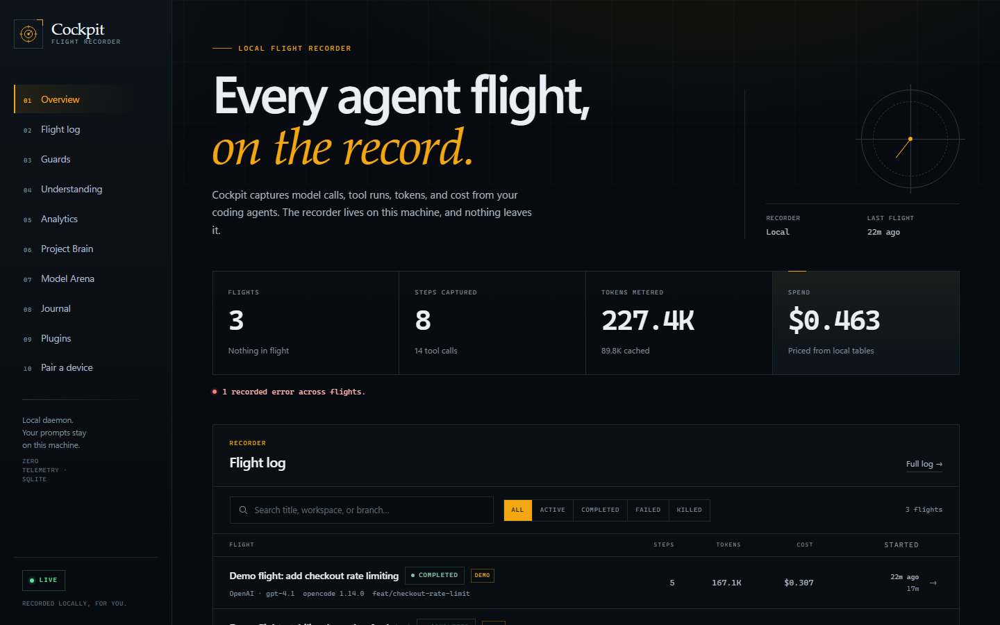
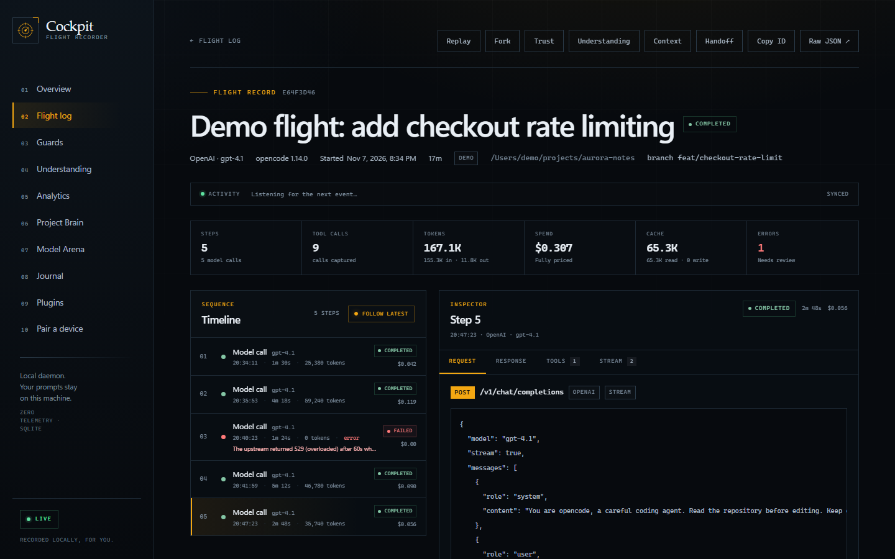
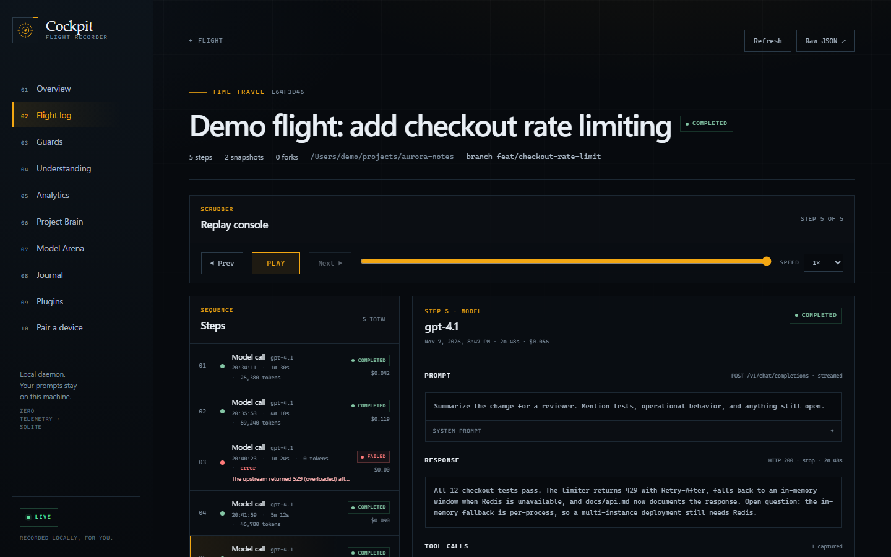
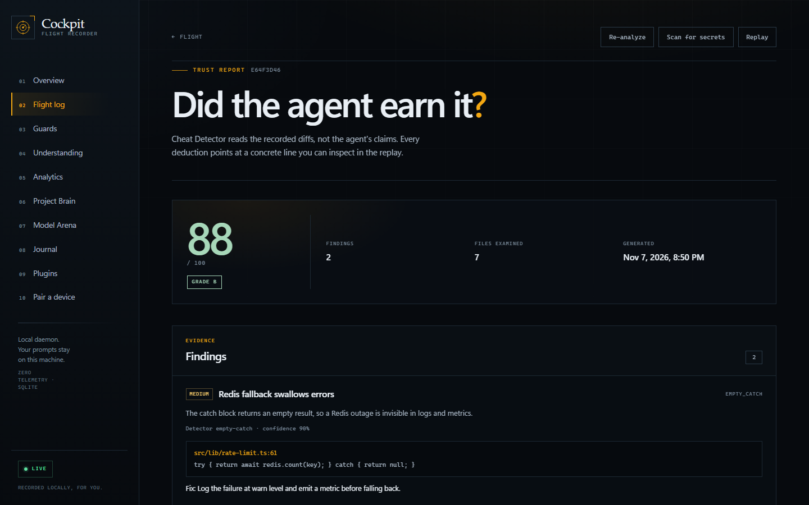
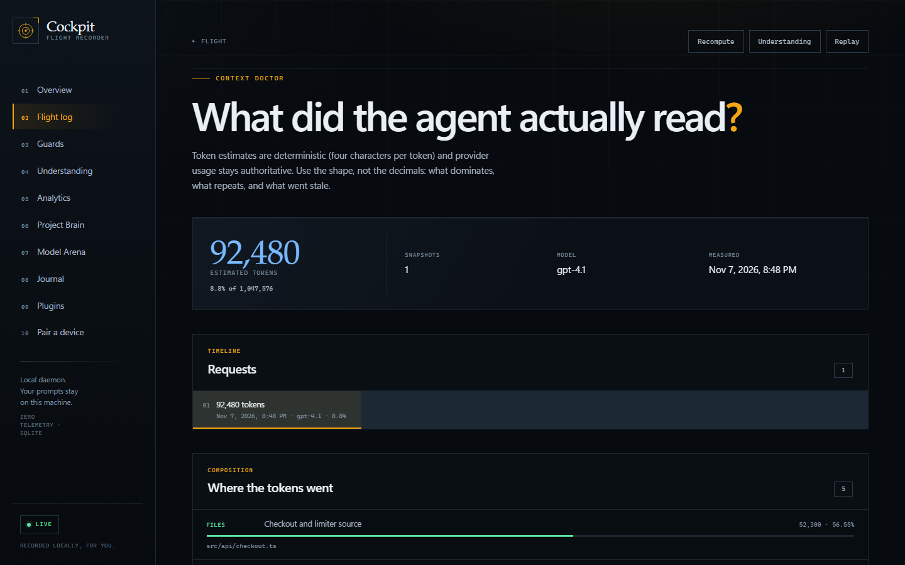
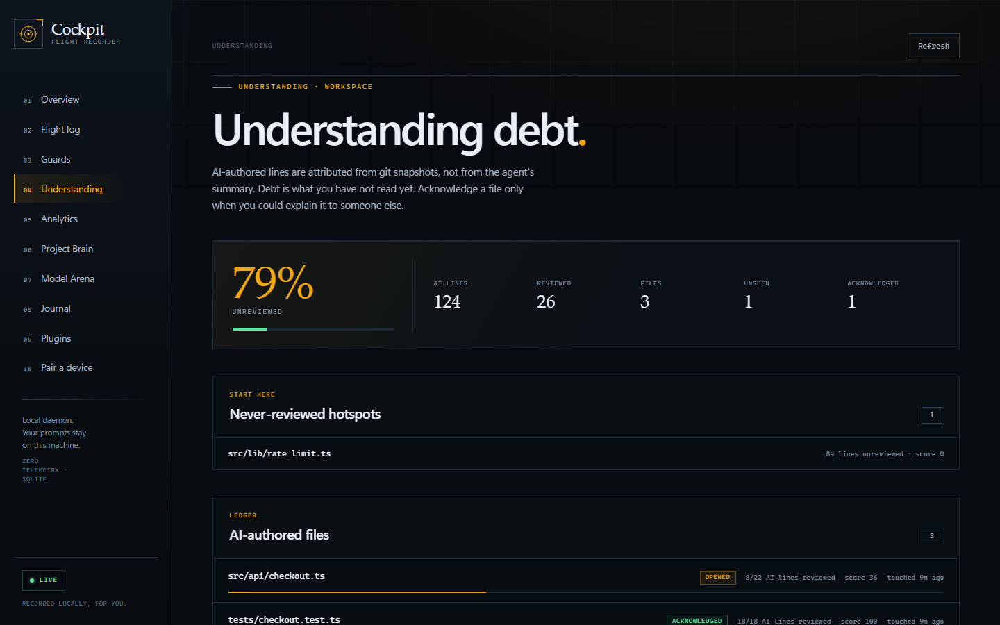
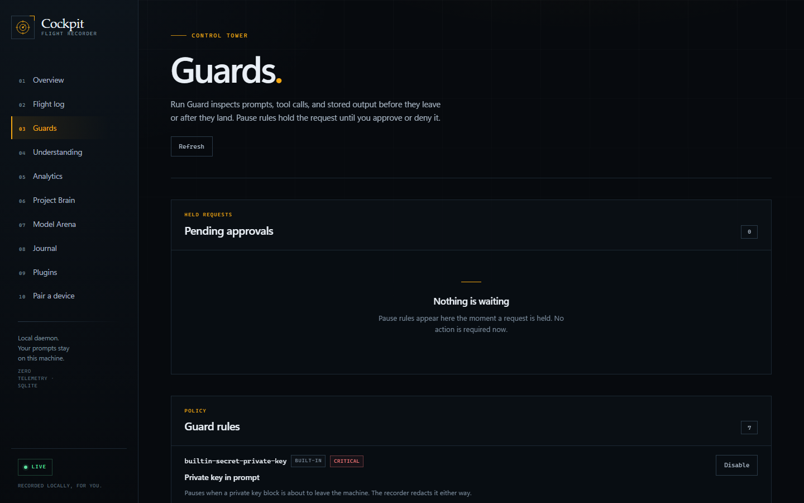
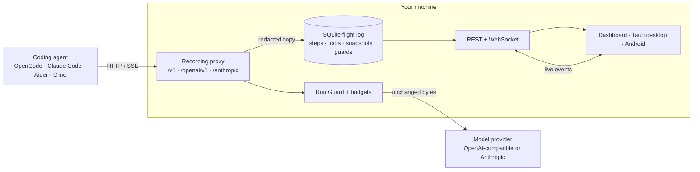

<div align="center">

# Cockpit

**The flight recorder and control tower for AI coding agents.**

Cockpit sits between your agent and its model provider. It records every prompt,
tool call, and git diff, streams the response through untouched, and keeps the
whole flight log in local SQLite. No account. No telemetry. No hosted control
plane.

[](LICENSE)
[](package.json)
[](tsconfig.base.json)
[](#privacy-promise)
[](#desktop-and-mobile)
[](CONTRIBUTING.md)

[](docs/assets/overview.png)

<sub>Real dashboard from `npx cockpit demo`. Synthetic data. No agent, provider, or telemetry service was contacted.</sub>

</div>

---

## Try it in 30 seconds

```bash
npx cockpit demo
```

Cockpit starts a local daemon, seeds three realistic flights, and prints a
dashboard URL:

```text
Cockpit demo seeded.

Dashboard: http://127.0.0.1:4319/
Flight:    http://127.0.0.1:4319/sessions/…

3 demo flights in …/projects/aurora-notes
8 steps, 14 tool calls, 2 guard events
Cockpit daemon started at http://127.0.0.1:4319.

Everything is local. No agent, provider, or telemetry service was contacted.
Demo data lives in ~/.cockpit/cockpit.db. Delete that file to remove it.
```

Open the dashboard. Click through the flight log, scrub the replay, read the
trust report, and inspect the context breakdown. The demo is idempotent: run it
again and it reuses the same flights.

Then record a real run:

```bash
# OpenCode
npx cockpit run --title "Add checkout rate limiting" -- opencode

# Claude Code
npx cockpit run -- claude

# Aider
npx cockpit run -- aider --model gpt-4.1
```

`cockpit run` starts the daemon when needed, creates an explicit session, points
the agent at the local proxy, and prints a review link. It preserves the API
keys already in your environment and never prints them.

**Requirements:** Node.js 22.11 or newer. `git` is optional; without it,
sessions still record but replay snapshots, trust analysis, and forks are
unavailable.

---

## Why Cockpit

Agent logs are scattered across terminals, IDE panels, and vendor dashboards.
They usually show the model call but not the tool calls, the file diffs, the
tokens that filled the context, or the moment a secret almost left the machine.

Cockpit records the whole flight at the proxy boundary, so it works the same
way for every agent that speaks OpenAI or Anthropic HTTP:

- **One record for every agent.** OpenCode, Claude Code, Aider, Cline, Codex,
  Cursor, and anything else that can set a base URL.
- **Evidence, not vibes.** Tool calls and file diffs are extracted from the
  recorded traffic and git snapshots. Unknown costs are recorded as unknown,
  never as `$0`.
- **A control tower, not just a log.** Run Guard pauses risky requests for a
  local decision, budgets enforce spending limits, and trust scoring reads the
  diff instead of the agent's summary.

---

## Screens

<table>
  <tr>
    <td width="50%"><a href="docs/assets/session.png"></a><br /><sub><b>Session inspector</b> — steps, usage, tool calls, and raw request/response.</sub></td>
    <td width="50%"><a href="docs/assets/replay.png"></a><br /><sub><b>Replay</b> — scrub the timeline and inspect prompts, tools, and diffs.</sub></td>
  </tr>
  <tr>
    <td width="50%"><a href="docs/assets/trust.png"></a><br /><sub><b>Trust report</b> — deterministic findings with file and line evidence.</sub></td>
    <td width="50%"><a href="docs/assets/context.png"></a><br /><sub><b>Context Doctor</b> — what filled the window and what went stale.</sub></td>
  </tr>
  <tr>
    <td width="50%"><a href="docs/assets/understanding.png"></a><br /><sub><b>Understanding debt</b> — AI-authored lines you have not reviewed yet.</sub></td>
    <td width="50%"><a href="docs/assets/guards.png"></a><br /><sub><b>Run Guard</b> — pause, approve, deny, and enforce local budgets.</sub></td>
  </tr>
</table>

More screens: [flight log](docs/assets/flight-log.png) ·
[analytics](docs/assets/analytics.png). Regenerate all of them with
`pnpm screenshots`.

---

## What it does

| Area           | What you get                                                                                                                                                                            |
| -------------- | --------------------------------------------------------------------------------------------------------------------------------------------------------------------------------------- |
| **Record**     | OpenAI Chat Completions and Responses-shaped traffic, Anthropic Messages, SSE passthrough without buffering, tool calls, stream chunks, token usage, cost, and pattern-based redaction. |
| **Inspect**    | Flight log with search and status filters, live WebSocket feed, step inspector, replay scrubber, git snapshots, per-file diffs, and fork-from-here worktrees.                           |
| **Protect**    | Run Guard pause/block rules, local approvals, spending budgets with warn/pause/block enforcement, secret rescans, and a deterministic trust score with evidence.                        |
| **Understand** | Provenance attribution from snapshot diffs, understanding debt, file explanations, comprehension quizzes, and Context Doctor composition insights.                                      |
| **Resume**     | Project Brain instruction files with drift detection, deterministic handoff briefs, and a weekly engineering journal.                                                                   |
| **Compare**    | Model Arena replays one recorded step against one to six `provider:model` targets and extracts a diff from each result.                                                                 |
| **Extend**     | Local guard and analyzer plugins, a typed REST API, live events, single-use pairing, a Tauri Windows shell, and a Capacitor Android client.                                             |

### Run Guard

Rules are evaluated before a request leaves and after a response lands. A
`pause` rule holds the request open until you approve or deny it; a `block` rule
rejects it with a provider-shaped error. If a guard fails unexpectedly, Cockpit
logs a warning and lets the request through rather than breaking the agent.

| Built-in rule         | Action | Catches                                                                  |
| --------------------- | ------ | ------------------------------------------------------------------------ |
| Private key in prompt | Pause  | PEM private key blocks about to leave the machine.                       |
| API key in prompt     | Warn   | Recognizable provider, GitHub, AWS, Google, Slack, bearer, and JWT keys. |
| Destructive command   | Pause  | `rm -rf /`, `mkfs`, `dd of=/dev/…`, pipe-to-shell, shutdown, `DROP`.     |
| Exfiltration endpoint | Pause  | Paste, webhook, tunnel, and file-drop services.                          |
| Git history rewrite   | Warn   | `reset --hard`, `clean -f`, force-push, `branch -D`, amend, rebase.      |
| Release or deploy     | Warn   | `npm publish`, `docker push`, `gh release`, Vercel, Netlify.             |
| Repeated instruction  | Warn   | The same instruction sent repeatedly without progress.                   |

Rules are conservative by design: a false pause is worse than a visible warning.
The dashboard and `cockpit guard` expose pending approvals, rule toggles, recent
events, and budget status.

### Replay and fork

When the workspace is a git repository, Cockpit captures a snapshot before the
first step and after every completed step. It uses a temporary index, so your
staging area, HEAD, branch, and reflog are untouched.

**Fork from here** creates a branch and worktree under `$COCKPIT_HOME/forks/`,
then writes `COCKPIT_RESUME.md` with the prompt, response, changed files, tool
calls, and a resume prompt for a fresh agent. Removing a fork deletes the
worktree but keeps the branch. Cockpit refuses to remove paths outside its own
forks directory.

---

## Supported agents

| Agent                                            | How to record                                                  | Guide                                                  |
| ------------------------------------------------ | -------------------------------------------------------------- | ------------------------------------------------------ |
| **OpenCode**                                     | `cockpit run -- opencode`                                      | [Getting started](docs/getting-started/opencode.md)    |
| **Claude Code**                                  | `cockpit run -- claude`                                        | [Getting started](docs/getting-started/claude-code.md) |
| **Aider**                                        | `cockpit run -- aider --model gpt-4.1`                         | [Getting started](docs/getting-started/aider.md)       |
| **Cline**                                        | Set the OpenAI-compatible base URL to a session route          | [Getting started](docs/getting-started/cline.md)       |
| **Codex, Cursor, Goose, Amp, Crush, Gemini CLI** | Wrap the command with `cockpit run -- <command>`               | [Architecture](docs/architecture.md)                   |
| **Anything OpenAI- or Anthropic-compatible**     | Point the client at `http://127.0.0.1:4319/v1` or `/anthropic` | [Architecture](docs/architecture.md)                   |

`cockpit run` sets `OPENAI_BASE_URL`, `OPENAI_API_BASE`, and
`ANTHROPIC_BASE_URL` to session-scoped routes. The ambient `/v1` and `/anthropic`
routes group calls into one ambient session per protocol and end after 30
minutes of inactivity.

---

## How it works



1. The agent sends an OpenAI or Anthropic request to a Cockpit route.
2. The route resolver picks the protocol and the target session.
3. Run Guard evaluates the request. A pause holds it for a local decision; a
   block returns a provider-shaped error.
4. The recorder stores a parsed, redacted copy of the request and forwards the
   original bytes upstream.
5. The response streams back to the agent without buffering. A tap copies
   chunks into the live feed and, when durable, into `stream_chunks`.
6. The step completes with status, usage, cost, tool calls, and latency.
7. A git snapshot runs when the workspace is a repository, which schedules
   secret rescans, trust analysis, provenance attribution, and understanding
   debt.

Read [docs/architecture.md](docs/architecture.md) for the storage model, package
layout, and remote-access boundary.

---

## Privacy promise

Cockpit is built for people who cannot send their source code to another
dashboard.

- **Zero telemetry.** No analytics, crash reporting, update pings, or hosted
  control plane. The binary does not phone home.
- **Loopback by default.** The daemon binds to `127.0.0.1:4319`. It does not
  listen on the network until you change `COCKPIT_HOST`.
- **Redaction before storage.** Sensitive headers and fields become
  `[REDACTED]`, and recognizable provider keys are scrubbed from free text
  before the stored copy is written. Forwarded bytes are never modified.
- **Local database.** Flights live in `~/.cockpit/cockpit.db` (or
  `$COCKPIT_HOME`). Delete the file to delete the history.
- **Honest limits.** The database is **not encrypted at rest**. Use full-disk
  encryption and a locked OS account. Redaction is pattern-based, not a
  data-loss-prevention guarantee.
- **No fake data outside demo mode.** Every non-demo number comes from recorded
  traffic. Unknown model prices are reported as unknown, never as `$0`.

The only network calls Cockpit makes are the model calls you already intended to
make, plus optional Arena runs you start explicitly. `cockpit demo` contacts
neither an agent nor a provider.

Read [docs/security.md](docs/security.md) for pairing, device tokens, plugin
isolation, and the full threat model.

---

## How it compares

|                                  | **Cockpit**                              | **Hosted LLM observability**      | **Agent-native logs** |
| -------------------------------- | ---------------------------------------- | --------------------------------- | --------------------- |
| Runs without an account          | Yes                                      | Usually not                       | Yes                   |
| Data stays on your machine       | Yes, local SQLite                        | Vendor cloud, unless self-hosted  | Yes                   |
| Works across agents              | Any OpenAI/Anthropic-compatible client   | SDK integration per app           | One agent             |
| Records tool calls and git diffs | Yes                                      | Traces; diffs vary by integration | Varies by agent       |
| Pause and approve before egress  | Yes                                      | Rare                              | No                    |
| Replay and fork a run            | Yes                                      | Partial                           | No                    |
| Cost accounting                  | Local price table; unknown stays unknown | Yes                               | Varies                |
| Telemetry from the tool          | None                                     | Vendor-dependent                  | None                  |
| License                          | MIT                                      | Proprietary or mixed              | Agent-dependent       |

Comparisons describe typical deployments, not every plan. Check each vendor's
current docs.

---

## CLI reference

Most commands that read data support `--json` for scripting. Run
`cockpit --help` or `cockpit <command> --help` for the full surface.

| Command                                                | What it does                                                                    |
| ------------------------------------------------------ | ------------------------------------------------------------------------------- |
| `cockpit start [--detach]`                             | Start the daemon in the foreground or background.                               |
| `cockpit run [--title …] -- <agent>`                   | Run an agent inside an explicit session.                                        |
| `cockpit demo`                                         | Seed three realistic flights without an agent.                                  |
| `cockpit doctor`                                       | Check Node, the database, the home directory, git, credentials, and the daemon. |
| `cockpit guard list / events / approve / deny`         | Inspect rules and resolve pending approvals.                                    |
| `cockpit guard scan <sessionId>`                       | Rescan a stored session for secrets.                                            |
| `cockpit trust <sessionId> [--recompute]`              | Show the trust score and evidence.                                              |
| `cockpit budget list / status / add / remove`          | Manage local spending policies.                                                 |
| `cockpit debt [sessionId]`                             | Show understanding debt for a flight or workspace.                              |
| `cockpit debt show / open / ack / explain / quiz <id>` | Work through an AI-authored file.                                               |
| `cockpit context <sessionId> [--recompute]`            | Inspect context composition and insights.                                       |
| `cockpit provenance <sessionId> [--recompute]`         | Show attributed AI-authored line ranges.                                        |
| `cockpit projects`                                     | List recorded projects.                                                         |
| `cockpit brain status / generate / sync <projectId>`   | Build and write project instruction files.                                      |
| `cockpit arena run / list / show`                      | Compare models on a recorded step.                                              |
| `cockpit handoff generate / list / show`               | Create and read resume briefs.                                                  |
| `cockpit analytics [--days N]`                         | Sessions, tokens, cost, models, and agents by day.                              |
| `cockpit journal list / generate / show`               | Weekly engineering journals.                                                    |
| `cockpit plugins list / install / run / runs / remove` | Install and run local plugins.                                                  |
| `cockpit pair [--wait]`                                | Create a single-use pairing code for desktop or Android.                        |
| `cockpit devices list / revoke`                        | Manage paired devices.                                                          |

`cockpit start --detach` prints the PID and log path. Stop the background daemon
with `kill <pid>` on macOS/Linux or `Stop-Process -Id <pid>` on Windows.

---

## Configuration

All settings are environment variables. Defaults are designed to work without a
config file.

| Variable                     | Default                     | Purpose                                                          |
| ---------------------------- | --------------------------- | ---------------------------------------------------------------- |
| `COCKPIT_HOME`               | `~/.cockpit`                | Home for the database, logs, snapshots, forks, and Brain output. |
| `COCKPIT_HOST`               | `127.0.0.1`                 | Bind address. Change only when you need remote access.           |
| `COCKPIT_PORT`               | `4319`                      | Daemon and dashboard port.                                       |
| `COCKPIT_DATABASE`           | `$COCKPIT_HOME/cockpit.db`  | SQLite path. Use `:memory:` for tests.                           |
| `COCKPIT_OPENAI_UPSTREAM`    | `https://api.openai.com`    | OpenAI-compatible upstream.                                      |
| `COCKPIT_ANTHROPIC_UPSTREAM` | `https://api.anthropic.com` | Anthropic upstream.                                              |
| `COCKPIT_OPENAI_API_KEY`     | none                        | Key injected when the client uses the `cockpit-proxy` sentinel.  |
| `COCKPIT_ANTHROPIC_API_KEY`  | none                        | Anthropic key injected for the sentinel.                         |
| `COCKPIT_ANTHROPIC_VERSION`  | `2023-06-01`                | Fallback Anthropic version header.                               |
| `COCKPIT_ALLOWED_ORIGINS`    | loopback origins            | Extra browser origins allowed by CORS.                           |
| `COCKPIT_PUBLIC_URL`         | none                        | Public origin used in pairing links behind a proxy or Tailscale. |
| `COCKPIT_SESSION_IDLE_MS`    | `1800000`                   | Ambient session idle timeout (30 minutes).                       |
| `COCKPIT_MAX_BODY_BYTES`     | `33554432`                  | Maximum request body (32 MiB).                                   |
| `COCKPIT_GUARD_APPROVAL_MS`  | `120000`                    | How long a paused request waits for a decision.                  |
| `COCKPIT_LOG_LEVEL`          | `info`                      | `silent`, `error`, `warn`, `info`, or `debug`.                   |
| `COCKPIT_DEMO`               | `false`                     | Marks the daemon as demo mode in `/api/health`.                  |

The dashboard is served by the daemon at the same origin. `COCKPIT_WEB_ROOT`
overrides the built dashboard directory for development.

---

## REST and live events

The dashboard uses the same public API. All responses are validated by shared
Zod schemas in `@cockpit/core`.

| Endpoint                               | Purpose                                                          |
| -------------------------------------- | ---------------------------------------------------------------- |
| `GET /api/health`                      | Version, protocol support, demo mode, and daemon status. Public. |
| `GET /api/stats`                       | Overview counters and recent flights.                            |
| `GET /api/sessions`                    | Flight log with search, status, agent, and pagination.           |
| `POST /api/sessions`                   | Create an explicit session.                                      |
| `GET /api/sessions/:id/steps`          | Step timeline for a flight.                                      |
| `GET /api/sessions/:id/replay`         | Snapshots, forks, and replay data.                               |
| `POST /api/sessions/:id/forks`         | Create a fork worktree.                                          |
| `GET /api/sessions/:id/trust`          | Trust score and findings.                                        |
| `GET /api/sessions/:id/context`        | Context snapshots and insights.                                  |
| `GET /api/guards/events`               | Guard events and pending approvals.                              |
| `POST /api/guards/events/:id/decision` | Approve or deny a paused request.                                |
| `GET /api/analytics`                   | Sessions, tokens, cost, and models over a window.                |
| `GET /api/ws`                          | Live lifecycle events and transient stream chunks.               |

Proxy routes: `/v1/...` auto-detects the protocol, `/openai/v1/...` forces
OpenAI, `/anthropic/...` forces Anthropic, and `/s/:sessionId/...` scopes a
route to one session.

When the daemon binds to a non-loopback address, `/api/*` and `/s/*` require
`Authorization: Bearer <device token>`. `GET /api/health` and
`POST /api/pairing/claim` stay public. Pairing management and demo seeding are
local-only. WebSocket clients pass the token as `?token=`.

---

## Desktop and mobile

- **Windows desktop:** a Tauri v2 shell in `apps/desktop` connects to a local
  daemon and embeds the dashboard in an iframe. Build with
  `pnpm --filter @cockpit/desktop build:native` (requires Rust). CI produces MSI
  and NSIS installers.
- **Android:** a Capacitor client in `apps/mobile` stores the daemon URL and
  device token locally, supports the `cockpit://pair` deep link, and provides
  Overview, Flights, and Settings tabs. Build with
  `pnpm --filter @cockpit/mobile android:sync` and Gradle (requires the Android
  SDK). CI produces a debug APK.

Pair a device with:

```bash
cockpit pair --name "Pixel 9"
```

The code is displayed as `XXXX-XXXX`, expires after five minutes by default, and
is single-use. Device tokens are hashed at rest and never appear in logs or the
live event feed.

---

## Documentation

| Document                                                            | What it covers                                              |
| ------------------------------------------------------------------- | ----------------------------------------------------------- |
| [Getting started: OpenCode](docs/getting-started/opencode.md)       | Wrap OpenCode, use the ambient proxy, troubleshoot.         |
| [Getting started: Claude Code](docs/getting-started/claude-code.md) | Point Claude Code at the Anthropic route.                   |
| [Getting started: Aider](docs/getting-started/aider.md)             | Use `OPENAI_API_BASE` and session routes.                   |
| [Getting started: Cline](docs/getting-started/cline.md)             | Configure the VS Code extension.                            |
| [Architecture](docs/architecture.md)                                | Request path, storage, clients, and remote-access boundary. |
| [Plugin guide](docs/plugins.md)                                     | Manifest, stdin/stdout contract, limits, and security.      |
| [Security model](docs/security.md)                                  | Assets, trust boundaries, pairing, redaction, and limits.   |
| [Good first issues](docs/good-first-issues.md)                      | Ten scoped contributions with acceptance criteria.          |
| [Contributing](CONTRIBUTING.md)                                     | Setup, checks, standards, and review expectations.          |
| [Roadmap](ROADMAP.md)                                               | What ships next and what is deliberately out of scope.      |

---

## Development

```bash
pnpm install
pnpm build
pnpm typecheck
pnpm lint
pnpm format:check
pnpm test
```

The built CLI is at `packages/cli/dist/index.js`:

```bash
node packages/cli/dist/index.js doctor
node packages/cli/dist/index.js demo
```

Use a throwaway home to keep demo data isolated:

```bash
COCKPIT_HOME=./.cockpit-dev node packages/cli/dist/index.js demo
```

Regenerate the README screenshots after a dashboard change:

```bash
pnpm build
pnpm screenshots
```

The script starts an in-memory daemon, seeds the demo, drives a locally
installed Chrome or Edge through the DevTools protocol, and writes
`docs/assets/*.png`. Set `COCKPIT_CHROME` to override browser detection.

---

## FAQ

### Does Cockpit send anything to the cloud?

No. There is no Cockpit-hosted service, account system, telemetry endpoint, or
background upload. The only outbound traffic is the model traffic your agent
already sends, plus Arena runs you explicitly start.

### Will it work with my agent?

If the agent can set `OPENAI_BASE_URL`, `OPENAI_API_BASE`, or
`ANTHROPIC_BASE_URL`, it can be recorded. `cockpit run` handles the common
coding agents; Cline and IDE extensions use a session-scoped base URL. See
[Supported agents](#supported-agents).

### Does recording slow down streaming?

No. Cockpit forwards SSE bytes as they arrive and records a copy through a tap.
It does not buffer the client response to parse it.

### Where is my data?

`~/.cockpit/cockpit.db` by default, with logs, snapshots, forks, and Brain
output under the same home. Set `COCKPIT_HOME` to move it. `cockpit demo` prints
the exact database path.

### Is the database encrypted?

Not yet. Cockpit does not encrypt SQLite at rest. Use full-disk encryption and a
locked OS account. Encrypted local storage is on the roadmap.

### Are provider keys stored?

Authorization headers and known key patterns are redacted before the stored copy
is written. The original bytes are forwarded upstream unchanged. Prefer
`COCKPIT_OPENAI_API_KEY` / `COCKPIT_ANTHROPIC_API_KEY` on the daemon over
long-lived keys in every agent environment.

### How do I remove the demo data?

Delete the database file printed by `cockpit demo`, or run the demo with a
throwaway `COCKPIT_HOME`. The demo never touches real flights.

### Can a team share one Cockpit?

Each machine records locally. A paired phone or another computer can reach a
daemon over a private network, and `COCKPIT_PUBLIC_URL` supports a TLS-terminating
proxy or Tailscale. There is no hosted team workspace and no cross-machine sync.

### Why "Cockpit"?

A flight recorder captures what actually happened, not what the pilot says
happened. The control tower decides what is allowed to take off. Cockpit gives
an agent run the same treatment.

### Is it production-ready?

0.1.0 is the first complete release: the proxy, storage, dashboard, replay,
guards, analysis surfaces, CLI, desktop shell, Android client, docs, and CI are
all in place. It is still pre-1.0; read [ROADMAP.md](ROADMAP.md) for the known
gaps and [SECURITY.md](SECURITY.md) for the security policy.

---

## Contributing

Contributions are welcome. Start with [CONTRIBUTING.md](CONTRIBUTING.md) and
[docs/good-first-issues.md](docs/good-first-issues.md). Run the full check suite
before opening a pull request.

- Report a bug with the issue template.
- Propose a feature with the workflow it unlocks, not only the UI.
- Report security issues privately through [SECURITY.md](SECURITY.md), never in a
  public issue.
- Be direct about the work and respectful to the people doing it. The
  [Code of Conduct](CODE_OF_CONDUCT.md) applies everywhere.

## License

MIT. See [LICENSE](LICENSE).

<div align="center">
<sub>Recorded locally, for you.</sub>
</div>
