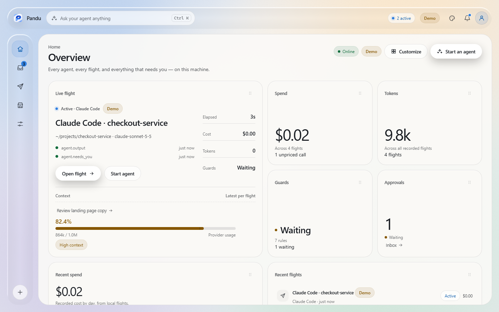
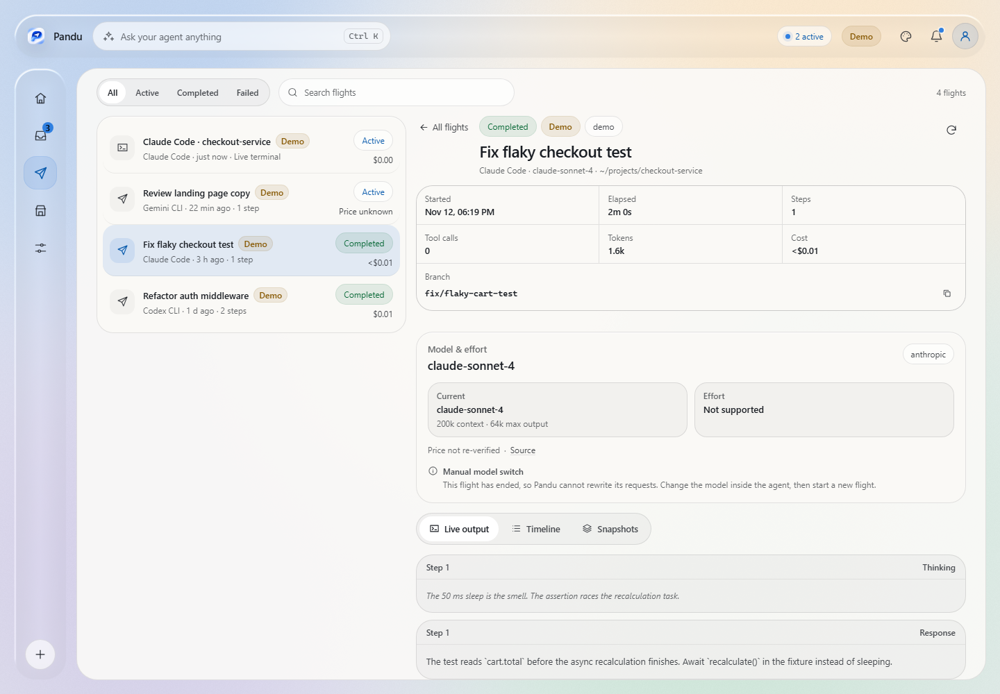
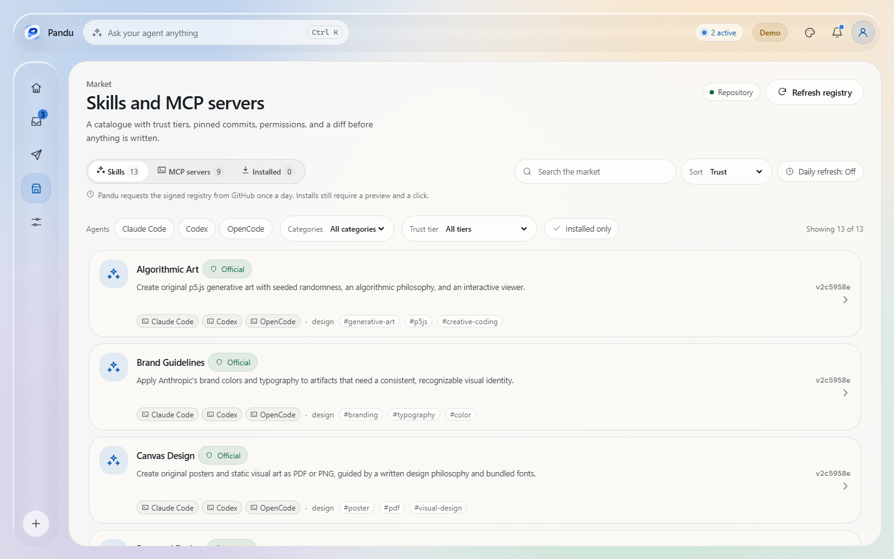
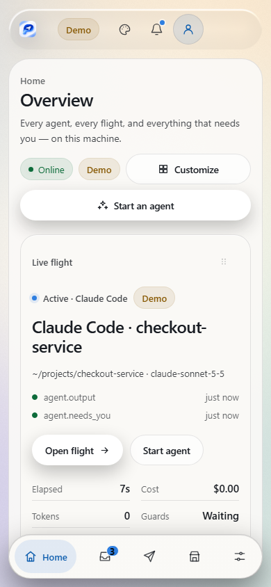
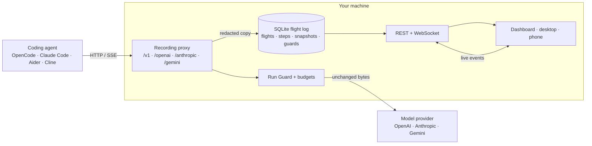

<p align="center">
  
</p>

<h1 align="center">Pandu</h1>

<p align="center">
  <strong>A local flight recorder and control tower for AI coding agents.</strong>
</p>

<p align="center">
  Pandu records what your agents do, shows it live, lets you replay every step,
  and asks permission before risky actions. It is not an AI agent; it guides,
  records, and protects the agents you already use. Everything stays on your
  machine — no account, no cloud, no telemetry.
</p>

<p align="center">
  <a href="https://github.com/ganddtn40/pandu/actions/workflows/ci.yml"></a>
  <a href="LICENSE"></a>
  
  
  
  
</p>

<p align="center">
  <a href="#quick-start">Quick start</a> ·
  <a href="#screens">Screens</a> ·
  <a href="#what-it-does">Features</a> ·
  <a href="#cli-reference">CLI</a> ·
  <a href="#documentation">Docs</a> ·
  <a href="docs/ROADMAP.md">Roadmap</a>
</p>

<p align="center">
  <picture>
    <source media="(prefers-color-scheme: dark)" srcset="docs/screenshots/readme/desktop-home-dark.png">
    
  </picture>
</p>

> **Status: pre-1.0.** The 0.2.0 rewrite is the active line on `main`. Phases
> 0–11 are complete; Phase 12 (docs, catalogs, release polish) is in progress.
> Windows and the PWA are supported. Android is an experimental companion
> verified on an emulator. macOS, iOS, and Linux are planned. English ships with
> 13 draft catalogs that fall back to English per key. Release builds currently
> fail closed for updates and the market until the production signing keys are
> provisioned. The 0.1.0 TypeScript/Node implementation is preserved under
> `legacy/` as the behavior spec.

## Contents

- [Quick start](#quick-start)
- [Why Pandu](#why-pandu)
- [Screens](#screens)
- [What it does](#what-it-does)
- [How it compares](#how-it-compares)
- [Run Guard](#run-guard)
- [Capture modes](#capture-modes)
- [Signed market](#signed-market)
- [Remote access](#remote-access)
- [Models, cost, and context](#models-cost-and-context)
- [How it works](#how-it-works)
- [Privacy and security](#privacy-and-security)
- [Platform support](#platform-support)
- [Design and appearance](#design-and-appearance)
- [CLI reference](#cli-reference)
- [Configuration](#configuration)
- [REST API and live events](#rest-api-and-live-events)
- [Benchmarks](#benchmarks)
- [Repository layout](#repository-layout)
- [Development](#development)
- [Documentation](#documentation)
- [FAQ](#faq)
- [Contributing](#contributing)
- [License](#license)

## Quick start

> **No tagged release is published yet.** The tag workflow builds the Windows
> installer, MSI, and portable CLI zip, then creates a draft release that a
> maintainer publishes by hand. Until that happens, build from source.

### From source

Requires Rust 1.89+, Node.js 24, and pnpm 12.9.1.

```powershell
git clone https://github.com/ganddtn40/pandu.git
cd pandu
pnpm --dir ui install
cargo run -p pandu-cli -- demo
```

Leave the daemon running, then start the UI in a second terminal:

```powershell
pnpm --dir ui dev
```

Open `http://127.0.0.1:5174`. The UI dev server talks to the daemon at
`http://127.0.0.1:4319`; `pandu demo` seeds demo flights on first start.

### Windows desktop app

The packaged desktop app bundles the daemon and the same UI in one window. Once
the release is published, download `Pandu_0.2.0_x64-setup.exe` (per-user NSIS)
or the `.msi` (per-machine) from Releases. To run the shell from source:

```powershell
pnpm --dir app install
pnpm --dir app exec tauri dev
```

The shell requires the Tauri 2 prerequisites and WebView2. The NSIS installer
needs no administrator rights; the MSI is a per-machine install.

### Command line

The CLI starts the daemon, runs agents, and exposes the API. It is headless: the
full workspace UI ships in the desktop app and the PWA. Build it with:

```powershell
cargo build -p pandu-cli --release
./target/release/pandu.exe demo
```

`pandu demo` prints the API base and the proxy base. The daemon serves a small
status page at `/` and the full API under `/api`.

### Record your first agent

```powershell
pandu run -- opencode
pandu run -- claude
pandu run -- aider
```

`pandu run` starts the daemon if it is not already running, matches the command
to a shipped adapter, points the agent at the local proxy, and launches it. The
agent receives a local sentinel key, not your provider key; the daemon swaps in
the real key when it forwards the request. Your provider key never enters the
agent's environment through Pandu.

Anything that can set `OPENAI_BASE_URL`, `OPENAI_API_BASE`,
`ANTHROPIC_BASE_URL`, or a Gemini base URL can be recorded without `pandu run`:
point it at `http://127.0.0.1:4319/v1` and open the desktop app or the UI dev
server.

## Why Pandu

Agent logs are scattered across terminals, IDE panels, and vendor dashboards.
They usually show the model call but not the tool calls, the file diffs, the
tokens that filled the context, or the moment a secret almost left the machine.

Pandu records the whole flight at the proxy boundary, so it works the same way
for every agent that speaks OpenAI, Anthropic, or Gemini HTTP:

- **One record for every agent.** OpenCode, Claude Code, Codex, Cursor, Aider,
  Cline, Gemini CLI, and anything else that can set a base URL.
- **Evidence, not vibes.** Requests, responses, tool calls, stream chunks, token
  usage, cost, and git diffs come from the recorded traffic. Unknown prices are
  reported as unknown, never as `$0`.
- **A control tower, not just a log.** Run Guard pauses risky requests for a
  local decision, budgets enforce spending limits, and approvals are bound and
  single use.
- **Local by default.** SQLite on disk, a loopback-only daemon, no telemetry,
  no TLS interception, and no credential capture.
- **Fail open.** A recording, storage, guard, or snapshot failure never changes
  or blocks the bytes travelling to your provider.

## Screens

Captured from the real app in explicit demo mode, so the `Demo` badge is part of
the UI. The hero above switches with your GitHub theme.

<table>
  <tr>
    <td width="50%">
      <a href="docs/screenshots/readme/desktop-flight-output.png"></a><br>
      <sub><b>Flight detail</b> — live output, model and effort, cost, and replay tabs in one view.</sub>
    </td>
    <td width="50%">
      <a href="docs/screenshots/readme/desktop-market.png"></a><br>
      <sub><b>Market</b> — signed skills and MCP servers with trust tiers and a preview before install.</sub>
    </td>
  </tr>
</table>

<p align="center">
  <picture>
    <source media="(prefers-color-scheme: dark)" srcset="docs/screenshots/readme/phone-home-dark.png">
    
  </picture>
</p>

<p align="center"><sub><b>Android companion</b> — experimental; verified on an emulator, not yet on a physical phone.</sub></p>

## What it does

| Area | What you get |
| --- | --- |
| **Record** | OpenAI Chat Completions and Responses, Anthropic Messages, Gemini `generateContent`, and OpenAI-compatible endpoints. Unbuffered SSE passthrough, tool calls, stream chunks, token usage, cost, context meter, and pattern-based redaction. |
| **Inspect** | Five tabs (Home, Inbox, Flights, Market, Settings), a live WebSocket feed, searchable flight list, flight detail, timeline scrubber, step inspector, per-step git diff, live terminal output, replay, and deep links. |
| **Protect** | Seven built-in Run Guard rules, local approvals with a countdown, budget policies with warn/pause/block enforcement, secret rescans, hashed pairing codes and device tokens, and a hash-chained remote audit log. |
| **Replay** | Reconstruct a recorded flight step by step, compare prompts and responses, inspect tool calls and diffs, and read the exact bytes the agent sent. Replay forks are deferred to a later release. |
| **Personalize** | Light, Dark, and Frost themes; three surface styles; seven accent presets; corner radius, density, fonts, glass intensity, wallpaper, and motion controls. Preferences are per-device and exportable as versioned theme JSON. |
| **Extend** | A typed REST API, live events, a signed skill and MCP registry, scoped remote access, and data-driven TOML adapters. |
| **Stay local** | SQLite on disk, loopback-only by default, no account, no cloud sync, no background update pings, and no telemetry. |

## How it compares

| | **Pandu** | **Hosted LLM observability** | **Agent-native logs** |
| --- | --- | --- | --- |
| Runs without an account | Yes | Usually not | Yes |
| Data stays on your machine | Yes, local SQLite | Vendor cloud unless self-hosted | Yes |
| Works across agents | Any OpenAI/Anthropic/Gemini-compatible client | SDK integration per app | One agent |
| Records tool calls and git diffs | Yes | Traces; diffs vary by integration | Varies by agent |
| Pause and approve before egress | Yes | Rare | No |
| Replay a recorded flight | Yes | Partial | No |
| Cost accounting | Local price table; unknown stays unknown | Yes | Varies |
| Telemetry from the tool | None | Vendor-dependent | None |
| License | MIT | Proprietary or mixed | Agent-dependent |

Comparisons describe typical deployments, not every plan. Check each vendor's
current documentation.

## Run Guard

Run Guard evaluates a request before it leaves the machine and records what it
saw. A `pause` rule holds the request open until you approve or deny it, up to
120 seconds (`PANDU_GUARD_APPROVAL_MS`). A `warn` rule records an event and lets
the request continue. If a guard fails unexpectedly, Pandu logs a warning and
forwards the request rather than breaking the agent.

| Built-in rule | Action | Catches |
| --- | --- | --- |
| Private key in prompt | Pause | PEM private key blocks about to leave the machine. The recorder redacts them either way. |
| API key in prompt | Warn | Recognizable provider, GitHub, AWS, Google, Slack, bearer, and JWT keys. |
| Destructive command | Pause | `rm -rf /`, `mkfs`, `dd of=/dev/…`, pipe-to-shell, shutdown, `DROP`. |
| Exfiltration endpoint | Pause | Paste, webhook, tunnel, and file-drop services. |
| Git history rewrite | Warn | `reset --hard`, `clean -f`, force-push, `branch -D`, amend, rebase. |
| Release or deploy command | Warn | `npm publish`, `docker push`, `gh release`, Vercel, Netlify. |
| Repeated instruction loop | Warn | The same instruction sent repeatedly without progress. |

Rules are conservative by design: a false pause is worse than a visible warning.
The Inbox shows pending approvals with large Approve/Deny cards and a countdown;
Settings shows rule toggles, recent events, and budget status. Budget policies
can warn, pause, or block at session, project, or global scope, over a session,
day, week, or month. High-risk remote approvals also require the pairing PIN.

The full threat model is in [`docs/security.md`](docs/security.md).

## Capture modes

### Proxy

The proxy is the primary recorder. It forwards the original bytes unchanged and
writes a parsed, redacted copy to SQLite. Streaming responses are not buffered
for parsing: a tap copies chunks into the live feed and, when durable, into the
database.

| Route | Behavior |
| --- | --- |
| `/v1/...` | Auto-detect the protocol from the path; OpenAI-compatible by default. |
| `/openai/v1/...` | Force OpenAI Chat Completions or Responses. |
| `/anthropic/v1/...` | Force Anthropic Messages. |
| `/gemini/v1beta/...` | Force Gemini `generateContent`. |
| `/s/<session-id>/...` | Bind the request to a known session, then apply the same rules. |

The ambient routes group calls into one session per protocol and end after 30
minutes of inactivity (`PANDU_SESSION_IDLE_MS`). A host-side model override
rewrites only the forwarded copy — the model and effort fields, plus the model
segment of a Gemini path. The recorded body always keeps what the agent actually
sent.

### Supported agents

Adapters are TOML data, not daemon code. All 15 ship in 0.2.0 and are embedded
in the binary; a user can add or override one in `<home>/adapters/`.

| Agent | Adapter | Planned capture |
| --- | --- | --- |
| OpenCode | `opencode.toml` | Proxy, log-watch |
| Claude Code | `claude-code.toml` | Log-watch |
| Codex CLI | `codex.toml` | Proxy, log-watch |
| Cursor CLI | `cursor-cli.toml` | Log-watch |
| GitHub Copilot CLI | `copilot-cli.toml` | Log-watch |
| Gemini CLI | `gemini-cli.toml` | Proxy, log-watch |
| Cline | `cline.toml` | Proxy |
| Roo / Kilo Code | `roo-kilo.toml` | Proxy |
| Aider | `aider.toml` | Proxy |
| Goose | `goose.toml` | Proxy, log-watch |
| Crush | `crush.toml` | Proxy |
| Pi | `pi.toml` | Proxy |
| OpenHands | `openhands.toml` | Proxy |
| Qwen Code | `qwen-code.toml` | Proxy, log-watch |
| Amp | `amp.toml` | Log-watch |

Every adapter starts with `verified = false` until its commands and paths are
checked against current vendor documentation. `pandu doctor` and the API surface
that flag. Adapter drift checks are still open in the
[roadmap](docs/ROADMAP.md). Adding an agent is a one-file pull request; see
[`adapters/README.md`](adapters/README.md).

### Log-watch

Log-watch observes an agent's local session files without touching its network
traffic. It is read-only: Pandu parses the files a named parser understands and
never writes to them. A missing file or a parser error produces a warning, not a
broken agent. Hook and OTel capture are deferred; the roadmap still tracks an
explicit per-flight capture label.

## Signed market

The Market tab installs skills and MCP servers from a signed registry. Pandu
never executes an installer: it writes the files the preview shows, and it
records every install so it can be undone.

| Tier | Meaning |
| --- | --- |
| **Official** | Maintained and reviewed in the Pandu repository. |
| **Community-reviewed** | Reviewed by a maintainer, with the review recorded in the entry. |
| **Unreviewed** | Not reviewed. Shown last by default; the preview still shows the exact files and commands. |

The index and the revocation list are signed with Ed25519. Every entry pins a
commit and a SHA-256 hash, shows its permissions, and has a preview before
install. Installs are host-only; the remote listener never mounts a market
route. When a verified registry is available, the last copy is cached under
`$PANDU_HOME/market/registry`, so the catalogue survives a restart and can be
browsed offline.

> **Signing status:** the market code, schema, fixtures, and signing tools ship,
> but the production trust root is not provisioned yet. Release builds therefore
> fail closed with **Registry is being prepared.**; debug builds and the
> screenshot suite use the separate test-signed fixtures. The test key is never
> used as a release fallback. See [`docs/registry/KEYS.md`](docs/registry/KEYS.md).

Read [`docs/market.md`](docs/market.md) for the schema, trust rules, offline
behavior, and contributor process.

## Remote access

Remote access is off by default and can only be enabled from the host. It runs a
separate listener on port `4320` and exposes a small, scoped API: it never
mounts the model proxy, the market, updates, backups, or remote-management
routes.

| Mode | What it does |
| --- | --- |
| **Tailscale** (recommended) | Pandu binds `127.0.0.1:4320`; `tailscale serve` provides HTTPS and a private network path. |
| **Cloudflare tunnel** | Pandu binds loopback; `cloudflared` publishes an HTTPS URL. A named tunnel with Cloudflare Access is the safer option. |
| **Local network** (discouraged) | Pandu binds the detected LAN address. Release builds require HTTPS; cleartext LAN HTTP is intentionally blocked. |

Pairing is host-confirmed. `pandu pair` issues a single-use code; the phone scans
the QR or types the short code, and the host approves the device. A device token
is 256 bits, delivered once, stored by the host only as a SHA-256 hash, and
compared in constant time. Tokens rotate on use with a 120-second overlap, and
revocation closes open WebSockets immediately. Pairing lasts 7, 14, 30, or 90
days.

| Scope | Grants |
| --- | --- |
| `view:status` | Flight metadata, totals, guard events, and agent status. A redacted view, not a content summary. |
| `view:content` | Steps, prompts, responses, diffs, and sanitized terminal output. Opt-in. |
| `respond` | Approve or deny guard events. High-risk approvals need the pairing PIN. |
| `prompt` | Keystroke injection into a running session, with host confirmation by default. |

New devices get Status only. The full endpoint-by-scope matrix, stolen-token
impact, and revocation steps are in [`docs/security.md`](docs/security.md); the
step-by-step setup guide is [`docs/remote-access.md`](docs/remote-access.md).

## Models, cost, and context

Pandu compiles a small, verified model table into the binary. It never fetches
prices or limits at runtime. The table covers OpenAI, Anthropic, Google, and
DeepSeek families, including the effort controls each provider understands.

- **Cost.** Prices are USD per million tokens. Each verified row carries a source
  URL and a `verifiedOn` date; retired rows kept for history are flagged. A row
  older than 60 days is marked **may be outdated**. An unknown price is shown as
  **Price unknown**, never as `$0.00`.
- **Effort.** The host can override the model and effort for a live session. The
  override is in-memory only, cleared when the flight ends, host-only, and
  audited without the request body or credentials.
- **Context.** The context meter uses the provider's reported prompt usage when
  available, otherwise a local estimate from the recorded request body. It makes
  no extra provider call and is stored in step metadata. The breakdown
  (`system`, `tools`, `history`, `files`, `other`) is labeled as an estimate.
- **Passthrough by default.** Without an override, the forwarded request is
  byte-identical to what the agent sent. An override rewrites only the forwarded
  copy. Replay and export show what the agent actually sent.

Read [`docs/models.md`](docs/models.md) for the full table and the override
safety rules.

## How it works



1. The agent sends an OpenAI, Anthropic, or Gemini request to a Pandu route.
2. The route resolver picks the protocol and the target session.
3. Run Guard evaluates the request. A pause holds it for a local decision; a
   budget rule can warn, pause, or block; a failure lets it through.
4. The recorder stores a parsed, redacted copy of the request and forwards the
   original bytes upstream.
5. The response streams back to the agent without buffering. A tap copies
   chunks into the live feed and, when durable, into `chunks`.
6. The step completes with status, usage, cost, tool calls, latency, and the
   context meter.
7. When the workspace is a git repository, a snapshot records the branch, base
   commit, file list, and patch. It uses a temporary index, so your staging area,
   HEAD, branch, and reflog are untouched.

The daemon is server-authoritative. Every remote argument is validated, every
state-changing route is rate limited, and no client-supplied path or scope is
trusted.

## Privacy and security

Pandu is built for people who cannot send their source code to another
dashboard.

- **Zero telemetry.** No analytics, crash reporting, update pings, or hosted
  control plane. The binary does not phone home.
- **Loopback by default.** The daemon binds `127.0.0.1:4319`. It does not listen
  on the network until you enable remote access from the host.
- **Redaction before storage.** Sensitive headers and recognizable provider keys
  become `[REDACTED]` before the stored copy is written. Forwarded bytes are
  never modified.
- **Local database.** Flights live in `~/.pandu/v2/pandu.db` (or
  `$PANDU_HOME`). Delete the file to delete the history.
- **No TLS interception, no credential capture.** Pandu never installs a
  certificate and never reads an agent's keychain or token store.
- **Hash-chained audit log.** Pairing, scopes, approvals, prompts (size and hash
  only), model overrides, and remote on/off are recorded. `pandu audit verify`
  checks the chain.
- **Backups can be encrypted.** `pandu backup --encrypt` uses XChaCha20-Poly1305
  with an Argon2id key. Remote device tokens are excluded unless
  `--include-remote` is passed.

### Honest limits

- The database is **not encrypted at rest**. Use full-disk encryption and a
  locked OS account. A process running as the same user can read it.
- Redaction is pattern-based. It is not a data-loss-prevention guarantee.
- Terminal output from a PTY session is held in daemon memory, capped, and never
  written to SQLite. It is still visible to the host UI and, with the Content
  scope, to a paired device.
- Android release builds block cleartext LAN HTTP. Emulator verification used
  loopback HTTP in a debug build; the HTTPS tunnel path and a physical phone
  remain unverified.
- The only outbound requests are the model calls you already intended, an
  explicit market refresh or install, an explicit update check, and the optional
  ntfy notification you configure.

Read [`docs/privacy.md`](docs/privacy.md) for what is stored, what is derived,
and how to delete it.

## Platform support

| Platform | Status | Notes |
| --- | --- | --- |
| Windows 10/11 (x64) | Supported | Desktop app, CLI, and installers. |
| Web / PWA | Supported | Served by the remote listener; installable when reached over HTTPS. |
| Android 10+ | Experimental | Companion viewer/approver, not a recorder. Verified on an emulator only. |
| macOS | Planned | No build yet. |
| iOS | Planned | No build yet. |
| Linux | Planned | No build yet. |

Android is a scoped companion: it can watch flights and answer approvals, but it
cannot start agents or change settings. The Windows app is a Tauri 2 shell that
embeds the daemon and the UI in one window; the Android companion pairs with a
QR code or short code and stores its device token locally. It pairs over an
HTTPS tunnel (`tailscale serve` or a Cloudflare tunnel); release builds
intentionally block cleartext LAN HTTP. The Android CI job is allowed to fail,
and Android is not part of a release until physical-phone verification is
recorded.

Nothing outside the supported rows is advertised as working.

## Design and appearance

- **Default accent:** blue `#2F7FE0`. Presets: Blue, Orange, Cream, Green,
  Violet, Silver, Mono.
- **Themes:** Light (default), Dark, Frost.
- **Surfaces:** Bento Matte, Liquid Glass, Hybrid (default: matte cards, glass
  floating layers).
- **Controls:** theme, surface, accent, corner radius, density, font and size,
  glass intensity/blur/refraction, wallpaper (procedural, your image, or none),
  card borders, motion (Full/Reduced/Off), Performance mode, and language, with
  instant live preview.
- **Per-device preferences.** Themes are versioned JSON (`pandu.theme`,
  version 1) that can be exported, imported, and shared. Imports are validated
  and never execute code. Wallpaper images stay on the device.
- **Widgets.** Home widgets are rearrangeable and hideable: drag on desktop,
  long-press on phone.
- **Honest demo mode.** A `Demo` badge appears in the top bar, and demo sessions
  and approvals carry a `Demo` chip. Demo data is only offered when the daemon
  runs with `PANDU_DEMO=1` or `pandu demo`.

The full contract, including tokens, contrast gates, and accessibility rules, is
in [`docs/DESIGN.md`](docs/DESIGN.md).

## CLI reference

Run `pandu --help` or `pandu <command> --help` for the full surface. Commands
that read data support `--json` for scripting.

| Command | What it does |
| --- | --- |
| `pandu serve` | Start the daemon. This is the default when no command is given. |
| `pandu demo` | Start the daemon with demo flights already seeded. |
| `pandu run -- <agent>` | Start the daemon if needed, then run an agent through the local proxy. |
| `pandu doctor` | Check the database, adapters, log watcher, and running daemon. |
| `pandu report` | Write a local diagnostic report. Nothing is uploaded. |
| `pandu pair` | Issue a pairing code for the phone companion. |
| `pandu audit verify` | Verify every audit entry against its hash and the previous entry. |
| `pandu models audit` | Fail when a bundled model row lacks control type, source, `verifiedOn`, or price evidence. |
| `pandu market keygen` | Generate an Ed25519 keypair for signing the registry. Maintainer tooling only. |
| `pandu market sign` | Sign the active registry variant in a directory. |
| `pandu market check` | Validate a registry directory, its signatures, hashes, and files. |
| `pandu update [--check]` | Check for and install a verified update. Never runs in the background. |
| `pandu rollback` | Restore the binary kept by the last update. |
| `pandu backup` | Write a local backup of the database and settings. |
| `pandu restore <archive>` | Restore a local backup. Remote access is off afterwards. |

Common flags: `--host`, `--port`, `--home`, `--database`, `--demo`,
`--openai-upstream`, `--anthropic-upstream`, and `--gemini-upstream`.

> Update checks are wired but fail closed in release builds until the production
> updater key is provisioned. Build from source in the meantime. See
> [`docs/updating.md`](docs/updating.md).

## Configuration

All settings are environment variables. Defaults are designed to work without a
config file.

| Variable | Default | Purpose |
| --- | --- | --- |
| `PANDU_HOME` | `~/.pandu/v2` | Home for the database, snapshots, backups, adapters, and market cache. |
| `PANDU_DATABASE` | `$PANDU_HOME/pandu.db` | SQLite path. Use `:memory:` for tests. |
| `PANDU_HOST` | `127.0.0.1` | Bind address. Only a loopback address or `localhost` is accepted. |
| `PANDU_PORT` | `4319` | Daemon, API, and status page port. |
| `PANDU_REMOTE_PORT` | `4320` | Remote listener port. `0` disables it. |
| `PANDU_REMOTE_PUBLIC_URL` | none | Public origin used in pairing links behind a tunnel or Tailscale. |
| `PANDU_OPENAI_UPSTREAM` | `https://api.openai.com` | OpenAI-compatible upstream. |
| `PANDU_ANTHROPIC_UPSTREAM` | `https://api.anthropic.com` | Anthropic upstream. |
| `PANDU_GEMINI_UPSTREAM` | `https://generativelanguage.googleapis.com` | Gemini upstream. |
| `PANDU_OPENAI_API_KEY` | none | Key injected when the client uses the local sentinel. |
| `PANDU_ANTHROPIC_API_KEY` | none | Anthropic key injected for the sentinel. |
| `PANDU_GEMINI_API_KEY` | none | Gemini key injected for the sentinel. |
| `PANDU_ANTHROPIC_VERSION` | `2023-06-01` | Fallback Anthropic version header. |
| `PANDU_ALLOWED_ORIGINS` | loopback origins | Extra browser origins allowed by CORS. Only loopback origins are accepted. |
| `PANDU_SESSION_IDLE_MS` | `1800000` | Ambient session idle timeout (30 minutes). |
| `PANDU_MAX_BODY_BYTES` | `33554432` | Maximum request body (32 MiB). |
| `PANDU_GUARD_APPROVAL_MS` | `120000` | How long a paused request waits for a decision. |
| `PANDU_DEMO` | `false` | Marks the daemon as demo mode and offers demo seeding. |
| `PANDU_LOG_WATCH` | `true` | Enable read-only log watching. |
| `PANDU_LOG_WATCH_INTERVAL_MS` | `2000` | Log-watch poll interval. |
| `PANDU_BUILTIN_ADAPTERS` | `true` | Load the embedded adapters. |
| `PANDU_NOTIFICATIONS` | `true` | Enable local agent notifications. |
| `PANDU_WORKSPACE` | current directory | Default workspace for snapshots. |
| `PANDU_SNAPSHOTS_DIR` | `$PANDU_HOME/snapshots` | Snapshot storage directory. |
| `PANDU_BACKUP_PASSPHRASE` | none | Non-interactive passphrase for `pandu backup --encrypt`. |

Notes:

- `RUST_LOG` controls tracing (default `info`); for example `RUST_LOG=debug`.
- `PANDU_MARKET_OFFLINE`, `PANDU_MARKET_REGISTRY`, and
  `PANDU_MARKET_REGISTRY_URL` are debug/test overrides. Release builds ignore
  them.
- The host listener serves a small status page at `/` and the API under `/api`.
  The remote listener serves the built UI from `PANDU_UI_DIR`, or from `ui/dist`
  when that directory exists.

## REST API and live events

The dashboard uses the same public API. The host listener mounts the routes
below; the remote listener mounts only the scoped `/api/remote/*` set described
in [Remote access](#remote-access).

| Endpoint | Purpose |
| --- | --- |
| `GET /api/health` | Version, protocol support, demo mode, and daemon status. Public. |
| `GET /api/overview` | Home aggregates: live flight, spend, tokens, guard state. |
| `GET /api/stats` | Overview counters and recent flights. |
| `GET /api/sessions` | Flight list with search, status, agent, and pagination. |
| `GET /api/sessions/{id}` | Flight detail. |
| `GET /api/sessions/{id}/steps` | Step timeline. |
| `GET /api/sessions/{id}/replay` | Replay data, snapshots, and diffs. |
| `GET /api/sessions/{id}/scan` | Rescan a stored flight for secrets. |
| `GET /api/sessions/{id}/budgets` | Budget status for a flight. |
| `GET /api/steps/{id}` | Step inspector payload. |
| `GET /api/snapshots/{id}` | Snapshot detail and patch. |
| `GET /api/guards/rules` | Guard rules. |
| `GET /api/guards/events` | Guard events and pending approvals. |
| `POST /api/guards/events/{id}/decision` | Approve or deny a paused request. |
| `GET /api/agents` | Running agent sessions. |
| `GET /api/agents/{id}/output` | Sanitized terminal output. |
| `GET /api/live` | WebSocket for lifecycle events and transient stream chunks. |
| `GET /api/models` | The bundled model table. |
| `GET /api/adapters` | Adapter registry and verification flags. |
| `GET /api/settings` | Settings. |
| `GET /api/market/catalog` | Signed market catalogue. |
| `GET /api/update` | Update status. Host-only. |

Proxy routes: `/v1/...` auto-detects the protocol, `/openai/v1/...` forces
OpenAI, `/anthropic/v1/...` forces Anthropic, `/gemini/v1beta/...` forces Gemini,
and `/s/<session-id>/...` binds a request to one session.

The main daemon rejects non-loopback binds, validates every remote argument, and
rate limits state-changing routes. The remote listener returns 404 for everything
outside its matrix, including the model proxy, market, updates, backups, and
remote-management routes.

## Benchmarks

Measured numbers for the packaged app, not estimates. Last measured on
2026-11-12 on Windows 11 (Ryzen 5 6600H, 16 GB, WebView2 157). The full report,
methodology, and reproduction commands are in
[`docs/BENCHMARKS.md`](docs/BENCHMARKS.md).

| Artifact | Size |
| --- | --- |
| `pandu.exe` (CLI) | 9.31 MB |
| `Pandu.exe` (desktop shell, unpacked) | 12.98 MB |
| `Pandu_0.2.0_x64-setup.exe` (NSIS) | 5.10 MB |
| `Pandu_0.2.0_x64_en-US.msi` | 6.93 MB |
| Portable CLI zip | 6.19 MB |
| Android arm64 release APK (test key) | 9.21 MB |
| Android universal release APK (test key) | 25.68 MB |

| Check | Budget | Actual | Result |
| --- | --- | --- | --- |
| CLI binary | < 12 MB | 9.31 MB | pass |
| Recorder idle RAM | < 40 MB | 34.8 MB | pass |
| Daemon ready | < 300 ms | 54 ms | pass |
| Android APK (arm64) | < 15 MB | 9.21 MB | pass |
| Initial host JS | < 90 KB gzip | 79.02 KB | pass |
| Total JS | < 200 KB | 163.73 KB | pass |
| CSS | < 30 KB | 20.48 KB | pass |

The whole-app working set is 396.9–426.6 MB and time to interactive is
540–814 ms. Almost all of that is WebView2; the Rust recorder stays around
33–35 MB and idle CPU is below 1.2% of one core. Windows working-set sums
double-count shared pages, so treat the whole-app figure as an upper bound.

Not measured: a physical Android phone, macOS/Linux/iOS builds, GPU and battery
drain, multi-hour soaks, histories beyond 500 flights, proxy p99 latency, and
signed builds.

## Repository layout

| Path | Purpose |
| --- | --- |
| `brand.json` | Single source of truth for every product name and identifier |
| `crates/pandu-core` | Domain types, pricing, adapters, redaction, SSE parsing |
| `crates/pandu-daemon` | Proxy, API, WebSocket, SQLite, watchers, guards, market |
| `crates/pandu-cli` | The `pandu` binary; starts the daemon and runs agents |
| `app` | Tauri 2 desktop app and Android companion |
| `ui` | Svelte 5 + TypeScript + Vite UI and the WebGL2 glass engine |
| `design` | Logo sources and export scripts |
| `adapters` | Data-driven TOML agent definitions |
| `registry` | Signed market entries, schema, fixtures, and signing tools |
| `docs` | Design, security, privacy, market, roadmap, install guides, issue drafts |
| `docs/screenshots/readme` | Screenshots used by this README |
| `packaging` | cargo-dist, winget/scoop drafts, release manifest, notices |
| `legacy` | Frozen 0.1.0 TypeScript/Node behavior spec |
| `.github` | CI, release automation, review routing (see [`.github/CONFIGURATION.md`](.github/CONFIGURATION.md)) |

## Development

### Requirements

- Rust 1.89+ (stable; `rust-toolchain.toml` pins the channel and components)
- Node.js 24 and pnpm 12.9.1 (the versions CI uses)
- Git (optional; snapshots degrade gracefully without it)
- Windows desktop builds: the Tauri 2 prerequisites and WebView2 (the installer
  downloads the bootstrapper when it is missing)
- Android builds: JDK 17, Android SDK, and NDK; see
  [`docs/install/android.md`](docs/install/android.md)

### Gates

Rust, from the repository root:

```powershell
cargo fmt --all -- --check
cargo clippy --workspace --all-targets -- -D warnings
cargo test --workspace
cargo check --release -p pandu-daemon
```

UI:

```powershell
pnpm --dir ui install
pnpm --dir ui check
pnpm --dir ui check:i18n
pnpm --dir ui test
pnpm --dir ui build
pnpm --dir ui exec playwright test
```

`pnpm --dir ui build` also enforces the JavaScript budgets. Playwright runs
`target/debug/pandu.exe`, so build the CLI first with
`cargo build -p pandu-cli`. Playwright starts disposable demo and live daemons;
it never touches your developer database.

### UI development

The UI preview is available at `http://127.0.0.1:5174` with
`pnpm --dir ui dev`, or `http://127.0.0.1:4174` with `pnpm --dir ui preview`
after a build. Start the daemon with `pandu serve` (or `pandu demo` for seeded
data). The UI calls `http://127.0.0.1:4319` on dev/preview ports and the same
origin otherwise.

### Screenshots

Regenerate the README gallery after a UI change:

```powershell
cargo build -p pandu-cli
pnpm --dir ui screenshots
```

The `README captures` block runs before the mutation tests and writes light and
dark variants to `docs/screenshots/readme/`. Keep every image under 500 KB; the
rules are in [`docs/assets/README.md`](docs/assets/README.md).

## Documentation

### Product

| Document | What it covers |
| --- | --- |
| [Design system](docs/DESIGN.md) | Tokens, surfaces, appearance, theme JSON, accessibility |
| [Remote access](docs/remote-access.md) | Tailscale, Cloudflare tunnel, pairing, scopes, revocation |
| [Security model](docs/security.md) | What is protected, stolen-token impact, endpoints × scopes |
| [Models, effort, and context](docs/models.md) | The verified model table, host-only overrides, context meter |
| [Privacy](docs/privacy.md) | What is stored locally, what can leave, how to delete it |
| [Data safety](docs/data-safety.md) | Where data lives, backups, migrations, uninstalls |
| [Market and registry](docs/market.md) | Trust tiers, signed registry, install previews, offline behavior |
| [Updating](docs/updating.md) | Update checks, signed installs, rollback, Android |
| [Translating](docs/TRANSLATING.md) | Catalog layout, coverage, drafts, RTL |
| [Rewrite decision record](docs/REWRITE.md) | What is kept, cut, and changed in 0.2.0 |
| [Roadmap](docs/ROADMAP.md) | v0.2.0 scope, phases, and deferred features |

### Install

| Document | What it covers |
| --- | --- |
| [English install guide](docs/install/en.md) | The full reference for desktop, CLI, Android, and PWA |
| [Android](docs/install/android.md) | Emulator, tunnel, and APK notes |
| [PWA](docs/install/pwa.md) | HTTPS requirements and install steps |
| [Troubleshooting](docs/install/troubleshooting.md) | Common install and startup problems |
| [Uninstall and cleanup](docs/install/uninstall.md) | Data retention and the leftover check |

**Beginner guides in 14 languages.** English is canonical; the other guides are
compact translations of the same steps.

| Language | Guide | Language | Guide |
| --- | --- | --- | --- |
| English | [en](docs/install/en.md) | Bahasa Indonesia | [id](docs/install/id.md) |
| Español | [es](docs/install/es.md) | Français | [fr](docs/install/fr.md) |
| Deutsch | [de](docs/install/de.md) | 日本語 | [ja](docs/install/ja.md) |
| 简体中文 | [zh](docs/install/zh.md) | العربية | [ar](docs/install/ar.md) |
| हिन्दी | [hi](docs/install/hi.md) | 한국어 | [ko](docs/install/ko.md) |
| Português (Brasil) | [pt](docs/install/pt.md) | Русский | [ru](docs/install/ru.md) |
| Türkçe | [tr](docs/install/tr.md) | Tiếng Việt | [vi](docs/install/vi.md) |

### Build and release

| Document | What it covers |
| --- | --- |
| [Adapter format](adapters/README.md) | How to add an agent |
| [UI notes](ui/README.md) | Glass engine, budgets, and commands |
| [Benchmarks](docs/BENCHMARKS.md) | Measured sizes, idle resources, TTI, uninstall hygiene |
| [Releasing](docs/RELEASING.md) | Gates, dry run, package-name checks, registry signing |
| [Code signing policy](docs/code-signing-policy.md) | What is signed, what is not, how to verify |
| [Registry keys](docs/registry/KEYS.md) | The empty trust root and the offline key ceremony |
| [GitHub configuration](.github/CONFIGURATION.md) | Workflows and review routing |
| [Install for agents](INSTALL-FOR-AGENTS.md) | Copy-paste setup for an AI agent |

### Community

| Document | What it covers |
| --- | --- |
| [Contributing](CONTRIBUTING.md) | Setup, gates, and where each change belongs |
| [Issue drafts](docs/issues/) | Ready-to-paste `help wanted` work |
| [Security policy](SECURITY.md) | Supported versions and private vulnerability reporting |
| [Code of conduct](CODE_OF_CONDUCT.md) | Participation rules |

## FAQ

### Does Pandu send anything to the cloud?

No. There is no Pandu-hosted service, account system, telemetry endpoint, or
background upload. The only outbound requests are the model calls your agent
already sends, an explicit market refresh or install, an explicit update check,
and the optional ntfy notification you configure.

### Will it work with my agent?

If the agent can set `OPENAI_BASE_URL`, `OPENAI_API_BASE`,
`ANTHROPIC_BASE_URL`, or a Gemini base URL, it can be recorded. `pandu run`
handles the 15 shipped adapters; IDE extensions use a base URL pointed at the
local proxy. See [Supported agents](#supported-agents).

### Does recording slow down streaming?

No. Pandu forwards SSE bytes as they arrive and records a copy through a tap. It
does not buffer the client response to parse it. Proxy p99 latency is not yet
measured, so this is a design property, not a benchmark claim.

### Where is my data?

`~/.pandu/v2/pandu.db` by default, with snapshots, backups, adapters, and the
market cache under the same home. Set `PANDU_HOME` to move it. `pandu demo`
prints the address to open; the database path is always
`$PANDU_HOME/pandu.db` unless `PANDU_DATABASE` overrides it.

### Is the database encrypted?

Not at rest. Use full-disk encryption and a locked OS account. Backups can be
encrypted with `pandu backup --encrypt` (XChaCha20-Poly1305 with an Argon2id
key).

### Are provider keys stored?

No. Authorization headers and recognizable key patterns are redacted before the
stored copy is written. The original bytes are forwarded upstream unchanged.
Prefer `PANDU_OPENAI_API_KEY`, `PANDU_ANTHROPIC_API_KEY`, and
`PANDU_GEMINI_API_KEY` on the daemon over long-lived keys in every agent
environment.

### How do I remove the demo data?

Stop the demo daemon, then delete `$PANDU_HOME/pandu.db` (or the path set by
`PANDU_DATABASE`), or run the demo with a throwaway `PANDU_HOME` or `--home`.
Demo rows are marked `demo: true` and never mix with real flights silently.

### Can a team share one Pandu?

Each machine records locally. A paired phone or another computer can reach a
daemon over a private network, and `PANDU_REMOTE_PUBLIC_URL` supports a
TLS-terminating proxy or Tailscale. There is no hosted team workspace and no
cross-machine sync.

### Why "Pandu"?

Pandu is Indonesian for guide. A flight recorder captures what actually
happened, not what the pilot says happened; the control tower decides what is
allowed to take off. Pandu gives an agent run the same treatment — it guides,
records, and protects the agents you already use.

### Is it production-ready?

It is pre-1.0. The proxy, storage, dashboard, replay, guards, market, remote
access, CLI, desktop shell, Android companion, docs, and CI are in place.
Windows and the PWA are supported; Android is experimental. Read
[`docs/ROADMAP.md`](docs/ROADMAP.md) for the open items and
[`SECURITY.md`](SECURITY.md) for the security policy.

## Contributing

Contributions are welcome when they keep the product local, honest, and
fail-open. Start with [CONTRIBUTING.md](CONTRIBUTING.md), read
[`AGENTS.md`](AGENTS.md) if you are an AI coding agent, and pick a
[`help wanted` draft](docs/issues/) for scoped work.

- Report a bug with the issue template.
- Propose a feature with the workflow it unlocks, not only the UI.
- Report security issues privately through [SECURITY.md](SECURITY.md), never in a
  public issue.
- Run the full gate suite before opening a pull request.
- Be direct about the work and respectful to the people doing it. The
  [Code of Conduct](CODE_OF_CONDUCT.md) applies everywhere.

## License

MIT. See [LICENSE](LICENSE).

---

<p align="center">
  <sub>Built with Rust, Svelte 5, and Tauri 2. Recorded locally, for you.</sub>
</p>
