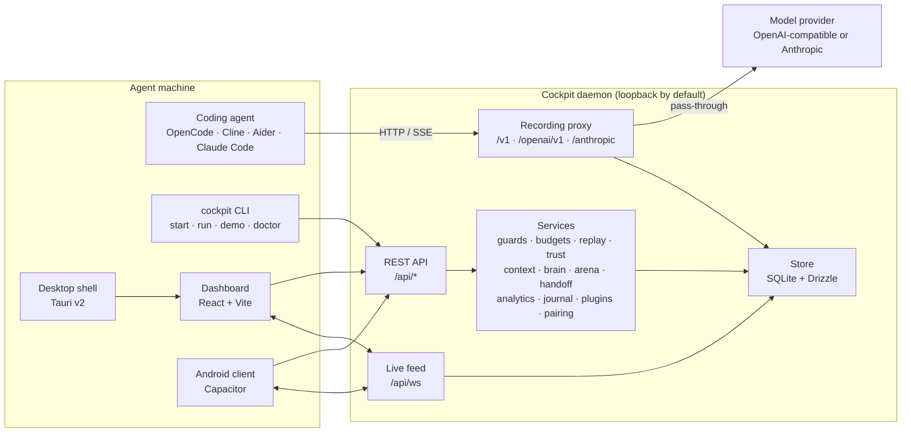

# Architecture

Cockpit is a local-first recorder. The daemon sits between an AI coding agent
and its model provider, forwards traffic without changing the agent's
experience, and writes a structured flight log to SQLite on the same machine.
There is no Cockpit-hosted service, no account, and no telemetry.

## System map

## Packages

| Path              | Responsibility                                                                                   |
| ----------------- | ------------------------------------------------------------------------------------------------ |
| `packages/core`   | Zod schemas, shared types, cost tables, trust scoring, event envelopes. No I/O.                  |
| `packages/daemon` | Hono app, recording proxy, SQLite schema and migrations, every local service, dashboard hosting. |
| `packages/cli`    | `cockpit` binary: daemon lifecycle, agent wrapper, doctor, demo, and service commands.           |
| `apps/web`        | React dashboard. Parses every API response through `@cockpit/core`.                              |
| `apps/desktop`    | Tauri v2 Windows shell. Starts or attaches to the daemon and embeds the dashboard in an iframe.  |
| `apps/mobile`     | Capacitor Android client. Pairs with a code, stores the device token locally, and reads the API. |
| `scripts`         | Build copy step, screenshot generation, and repository automation.                               |

## Request path

1. The agent sends an OpenAI or Anthropic request to a Cockpit route.
2. The route resolver picks the protocol and the target session:
   - `/s/:sessionId/...` records into an explicit session;
   - `/openai/v1/...` and `/anthropic/...` force a protocol;
   - `/v1/...` auto-detects from the path and body.
3. Run Guard evaluates the request. A `pause` rule holds the request open for a
   local decision; a `block` rule returns a provider-shaped error.
4. The recorder parses a copy of the request, redacts secrets, and inserts a
   step row. The original bytes are forwarded upstream.
5. The upstream response is streamed back to the agent. SSE bytes are not
   buffered for recording; a tap copies chunks into the live feed and, when
   durable, into `stream_chunks`.
6. The recorder completes the step with status, usage, cost, tool calls, and
   latency. Session totals are updated in the same transaction.
7. A git snapshot runs before the first step and after each completed step when
   the workspace is a git repository.
8. Snapshot changes schedule guard rescans, trust analysis, provenance
   attribution, and understanding-debt synchronization.

Errors never break the agent by default. If a guard or a recorder step throws,
the daemon logs a warning and lets the request through. The one exception is an
explicit `block` rule or a budget `block` policy.

## Recording and redaction

The proxy forwards request bodies byte-for-byte. It stores a parsed copy so the
dashboard can display prompts, responses, tool calls, and usage. Sensitive
headers and fields are replaced with `[REDACTED]`, and known provider key
patterns are scrubbed from free text before the copy is written. Redaction is
pattern-based: it reduces accidental exposure but is not a guarantee. The
database itself is not encrypted at rest; protect the Cockpit home directory
with your operating system account and disk encryption.

Token accounting is canonical: `inputTokens` is uncached input only; cache
reads, cache writes, and reasoning tokens are separate. Unknown models are
recorded as unpriced instead of `$0`.

## Storage

SQLite is opened through `better-sqlite3` and accessed with Drizzle. The schema
lives in `packages/daemon/src/db/schema.ts`; generated migrations live in
`packages/daemon/drizzle` and are applied at startup. The database covers:

- sessions, steps, tool calls, stream chunks, and redactions;
- git snapshots, file changes, replay forks;
- guard rules and events, budget policies;
- trust analyses and cheat findings;
- provenance entries, understanding files, events, and quizzes;
- context snapshots, segments, and insights;
- projects, Project Brain sources and outputs, drift events;
- arena runs, handoff briefs, journal entries, plugins and plugin runs;
- pairing tokens and paired devices.

Live events are durable when they describe lifecycle changes. `stream.chunk`
events are transient: they reach WebSocket subscribers but are not written to
the event table.

## Dashboard and clients

The daemon serves the built dashboard from the same loopback origin as the API.
`apps/web` uses one shared WebSocket for lifecycle events and updates stream
previews in place. Every response is validated with the shared Zod schemas, so
a daemon change that breaks the contract fails loudly in development.

The Tauri shell embeds the dashboard and adds a native launcher. The Capacitor
client talks directly to the daemon after pairing and keeps its device token in
local storage. Both are thin clients: no recording logic lives outside the
daemon.

## Remote access boundary

Loopback is trusted. When the daemon binds to a non-loopback address:

- `/api/*` and `/s/*` require `Authorization: Bearer <device token>`;
- `/api/health` and `/api/pairing/claim` stay public;
- pairing-session management and demo seeding are local-only;
- a remote device may only revoke itself;
- WebSocket clients pass the token as `?token=`.

Pairing codes are single-use, expire after five minutes by default, and are
hashed at rest. Device tokens are random 256-bit values with a `ckp_` prefix and
are also hashed at rest. Pairing links can be generated with
`COCKPIT_PUBLIC_URL` when the daemon is behind a reverse proxy or Tailscale.

Cockpit does not terminate TLS. If traffic leaves the machine, put the daemon
behind a TLS-terminating proxy or a private network such as Tailscale, and keep
the bind address as narrow as possible.

## Build and packaging

`pnpm build` builds every package, then `scripts/copy-web.mjs` copies the
dashboard bundle into `packages/daemon/dist/web` and `packages/cli/dist/web`.
The CLI is bundled with tsup; the daemon package ships its `dist` and `drizzle`
migrations. Native desktop and mobile builds are separate from the root
JavaScript build:

- Tauri: `pnpm --filter @cockpit/desktop build:native` (requires Rust);
- Android: `pnpm --filter @cockpit/mobile android:sync` then Gradle.

## Design constraints

- **Local-first.** No hosted control plane, no telemetry, no background upload.
- **Honest data.** Unknown cost is unknown; absent snapshots are absent, never
  synthesized outside demo mode.
- **Deterministic analysis.** Trust, provenance, context insights, Project
  Brain, handoffs, analytics, and journals are computed locally. The only model
  calls are the agent traffic you send through the proxy and explicit Arena
  runs.
- **Strict contracts.** TypeScript strict mode, `noUncheckedIndexedAccess`,
  `exactOptionalPropertyTypes`, and Zod at every boundary.
- **Small blast radius.** Plugins run in a child process with a minimal
  environment. Forks are restricted to Cockpit's own directory. The dashboard
  has a strict CSP.
