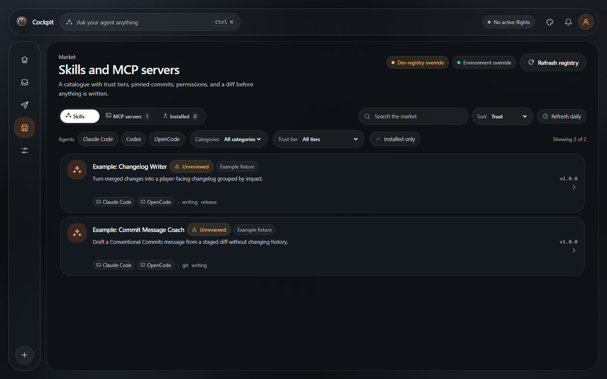
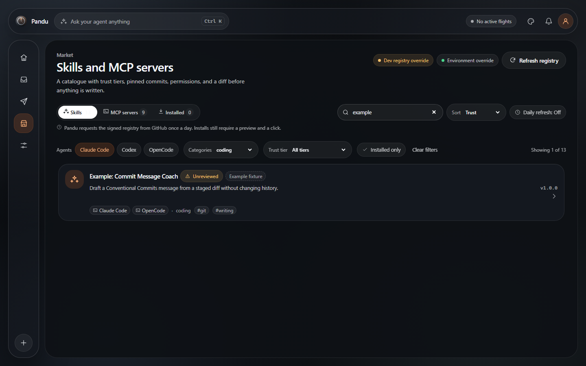
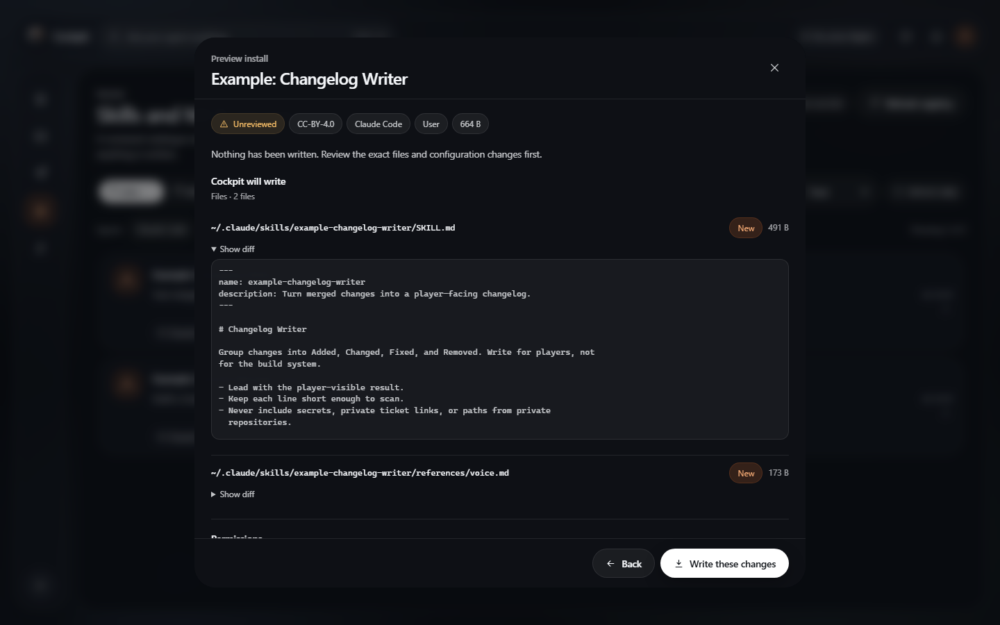
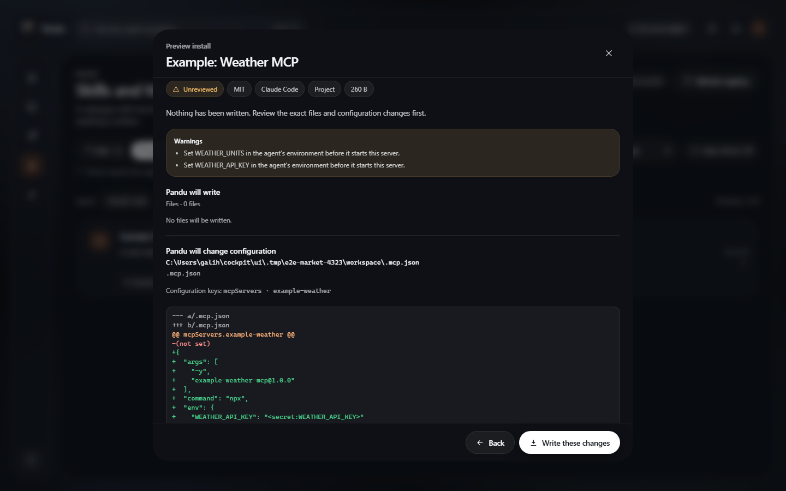
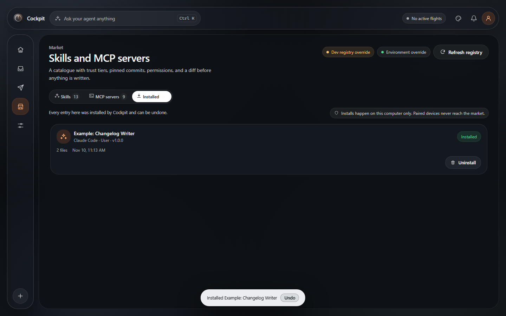
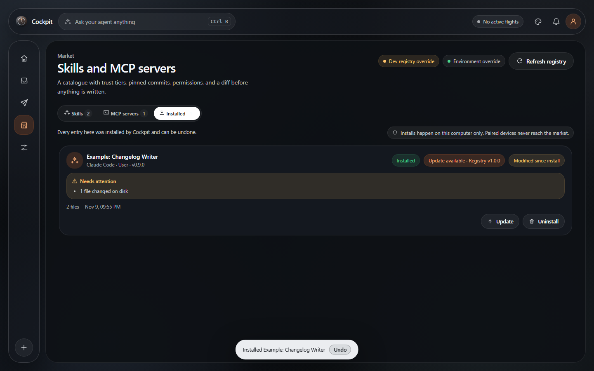
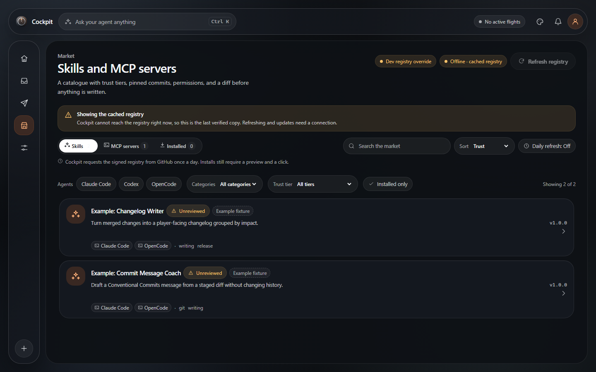

# Market

Status: 0.2.0. Market is the Pandu catalogue for agent skills and MCP
servers. It is **host-only**, **signed**, and **never executes an installer**.
Pandu copies files and edits configuration; the agent runs the installed
skill or MCP server later, under the user's account.



## The promise

- Every card shows a trust tier: **Official**, **Community-reviewed**, or
  **Unreviewed**. Pandu does not use "Verified" as a tier.
- Every entry pins a GitHub repository and a full commit SHA. The downloaded
  tree must match a content SHA-256 before anything is written.
- The index and the revocation list are signed with Ed25519. If a signature,
  an entry hash, or the revocation list fails, Pandu refuses the registry and
  explains why. It does not fall back to unverified data.
- Nothing is installed from a card click. The preview shows the exact files,
  configuration keys, real diff, permissions, source, license, tier, and (for
  MCP) the command the agent will run. The user confirms.
- Pandu never runs `npm`, `npx`, `pip`, `uv`, a shell script, or an MCP server
  during install. It only writes files and configuration.
- Installs happen on the computer running the daemon. A paired remote device
  cannot reach `/api/market/*`; those paths return 404 on the remote listener.
- Network access happens only on an explicit refresh or install, or on the
  opt-in daily refresh. There is no telemetry, install count, or background
  phone-home.
- README images are blocked by default, and README HTML is stripped. The README
  is displayed as sanitized plain text.

The scans in the registry CI are **heuristics, not a guarantee**. A clean scan
means the obvious patterns were not found; it does not prove the code is safe.
Read the source and the preview before installing.

## Trust tiers

| Tier | Meaning | What Pandu checks |
| --- | --- | --- |
| **Official** | Maintained by the Pandu project. | A named reviewer, a review date, and CI passed. |
| **Community-reviewed** | Inspected by a named maintainer. | A named reviewer, a review date, and CI passed. |
| **Unreviewed** | Not reviewed. Shown last by default. | Schema, signature, pinned commit, content hash, and static scans only. |

"Signature verified" in the detail sheet means the signed index was verified. It
does **not** mean the entry was reviewed. The tier is the review claim.

The UI links to the policy sheet from every catalogue view:



## Using Market

Market is a tab in the main UI.

- **Skills** lists skill entries.
- **MCP servers** lists MCP entries.
- **Installed** lists everything Pandu installed, including uninstalled rows
  that can be restored with Undo.

Catalogue controls:

- **Search** is instant and client-side. It matches the name, descriptions,
  categories, tags, and agent ids.
- **Agents** is a multi-select chip row. Selecting two agents shows entries that
  support either one; the detail sheet then lets the user choose the target.
- **Categories** is a single-select over the controlled vocabulary (`coding`,
  `testing`, `security`, `docs`, `devops`, `data`, `design`, `productivity`,
  `other`). Free-form labels are shown as tags and are searchable, but they are
  never filter categories. **Trust tier** is also single-select. **Installed
  only** hides everything that is not installed.
- **Sort** is Trust (default), Name, or Installed first. Unreviewed entries sort
  last.
- **Refresh registry** downloads the signed index, revocation list, and every
  entry, verifies all of them, and only then replaces the cache. A failed
  refresh leaves the previous verified cache untouched.
- **Refresh daily** is off by default. When enabled, Pandu checks at most once
  per 24 hours. It still never installs or updates automatically.

The list is virtualized, so a registry with more than a thousand entries keeps
scrolling smooth.

### Detail

Selecting a card opens a sheet with:

- the README, rendered as sanitized plain text;
- declared permissions (`filesystem:read`, `filesystem:write`, `network`,
  `shell`, `secrets`, `clipboard`);
- supported agents and scopes;
- the source repository, pinned commit, license, reviewer, review date, and CI
  result;
- for MCP, the exact command and arguments the agent will run.


### Install preview

Choose an agent and a scope, then **Preview install**. Pandu resolves the
adapter target, downloads the pinned tree, verifies its hash, and builds a plan.
Nothing is written yet. The preview shows:

- every file with **New**, **Overwrite**, **Unchanged**, or **Conflict**;
- a real line diff for text files that already exist;
- the configuration path and key path for MCP, and the value Pandu will add;
- required secret names and local inputs;
- declared permissions, source, license, and tier;
- the exact MCP command, with the warning that the agent will execute
  third-party code when it starts the server.



Conflicts are never overwritten silently. The confirm button stays disabled
until the user has reviewed the plan. A preview is held in memory for ten
minutes and can be used once; a stale or reused preview is refused.

For MCP, secrets are asked for locally and only at install time. They are
written to the agent configuration where the agent expects a literal value.
They are **not** stored in the registry, the Pandu database, or the install
manifest. OpenCode always receives `{env:NAME}` references instead of literal
values.



### Result, undo, and uninstall

After a successful install, the result sheet lists what was written and offers
**Undo**. The success toast carries the same **Undo** action for 30 seconds, so a
mistake can be reverted without reopening the sheet. Undo restores the backup
and removes the install record.

The **Installed** tab keeps a row for every install:

- **Installed** with an available update shows an **Update available** pill and
  **Update**. An update is a new preview and a new confirmation; Pandu never
  auto-updates.
- **Modified since install** appears when any installed file no longer matches
  the recorded hash, or the configuration Pandu wrote changed. The row also
  shows **Needs attention** with the specifics. Local edits never trigger an
  update or an automatic overwrite.
- **Revoked** means the signed revocation list marks the entry as unsafe or
  broken. The row explains why and offers **Remove now**.
- **Needs attention** means a file or configuration key changed on disk, is
  missing, or no longer matches the manifest. Pandu does not delete a file it
  cannot prove it created.
- **Uninstalled** rows stay visible so **Undo** can restore them.

Uninstall removes only files Pandu created and that still match the recorded
hashes. If a file was edited, the preview lists it and requires an explicit
confirmation before removing it. Configuration keys are removed only if their
current value still matches what Pandu wrote. A backup is kept so the removal
can be undone.





## The install pipeline

1. **Load and verify the registry.** The signed index is verified against the
   embedded Ed25519 public key. Every entry file must match the SHA-256 in the
   index. The revocation list must verify too. Any failure refuses the whole
   registry.
2. **Resolve the target.** The entry must name the chosen agent. The adapter
   must have a verified `[skills]` or `[mcp]` section. If the target is not
   verified, Pandu writes nothing and shows manual instructions with a copy
   button. Some agents keep app state in their user-level MCP file; those
   adapters set `write_user_config = false` and Pandu offers the agent's own
   add command or the project-scope file instead. Claude Code's `~/.claude.json`
   is one of these files.
3. **Fetch the pinned source.** For a skill, Pandu downloads
   `https://codeload.github.com/<owner>/<repo>/tar.gz/<commit>`. Redirects are
   not followed; the host is GitHub. The archive is capped at 20 MiB and the
   extracted tree at 40 MiB, 1,000 files, and 4 MiB per file.
4. **Extract safely.** Absolute paths, `..`, NUL, drive/stream separators,
   symlinks, hard links, unsupported entry types, Windows reserved names,
   case-colliding paths, over-long components, and over-long full paths are
   rejected. The whole tree is hashed and compared with
   `source.content_sha256`.
5. **Build the plan.** Pandu plans file writes and a configuration edit. TOML
   edits use `toml_edit`; JSON/JSONC edits preserve comments and unknown keys.
   BOM, CRLF, trailing commas, and everything outside the edited key keep their
   exact bytes. Existing values are compared so an unchanged key is not
   rewritten. A file that does not parse is refused instead of being replaced.
6. **Preview and confirm.** The preview shows the resolved absolute path and a
   compact diff of only the edited key, not the whole file. Values under
   `env`/`environment` and values with secret-like names are redacted. A
   conflict blocks the install. Pandu records the file hash, size, and
   modification time at preview time.
7. **Back up and write.** Existing files and configuration are backed up under
   the Pandu home in a timestamped folder. Before writing, Pandu re-checks
   that every previewed file still matches; if an editor saved in between, the
   install aborts and asks for a new preview. A journal is written, files are
   written to a temporary path and renamed atomically, and the target's existing
   permissions are preserved. If the process dies mid-install, the journal is
   rolled back on the next start.
8. **Record the manifest.** The manifest stores the entry id, version, trust
   tier, source, license, agent, scope, target root, file hashes, config path and
   redacted value, backup id, permissions, and secret **names**. Secret values
   are never stored.
9. **Uninstall or undo.** Uninstall removes only matching Pandu-created files
   and unchanged configuration keys. Undo restores the backup.

An MCP install has no source files to copy. Pandu writes the server recipe to
the agent configuration and shows the command. The agent starts the server; the
daemon never does.

## Supported agents and scopes

Only targets marked verified in an adapter are written. Everything else is
manual-only, with the exact path and steps shown in the UI.

| Agent | Skills | MCP | Verified locations |
| --- | --- | --- | --- |
| **Claude Code** | Yes | Yes | Skills: `~/.claude/skills`, `.claude/skills`. MCP: `.mcp.json` (`mcpServers`). User-scope `~/.claude.json` is manual-only because it also holds app state. |
| **OpenCode** | Yes | Yes | Skills: `~/.config/opencode/skills`, `.opencode/skills`. MCP: `~/.config/opencode/opencode.json(c)`, `opencode.json(c)`, `.opencode/opencode.json(c)` (`mcp.servers`, JSONC). |
| **Codex CLI** | Yes | Yes | Skills: `~/.agents/skills`, `.agents/skills`. MCP: `~/.codex/config.toml`, `.codex/config.toml` (`[mcp_servers.<name>]`). Codex also reads ancestor `.agents/skills` and admin `/etc/codex/skills`; Pandu writes only the user or project path. |
| Other adapters | Manual only | Manual only | No verified market target; Pandu refuses to guess. |

Scope:

- **User** writes to the user's home and affects every project for that agent.
  If the adapter sets `write_user_config = false`, user-scope MCP shows the
  agent's add command and a project-scope alternative instead of editing an
  app-state file.
- **Project** writes inside the current workspace and affects that project.
  Pandu only offers project scope when the daemon knows a workspace.

## Updates and revocation

- An update is detected when the signed registry lists a newer `version` or a
  different `source.commit` for an installed entry.
- The Installed tab shows **Update available**. Opening it runs the same preview
  and diff against the installed files, then requires a confirmation. There is
  no auto-update, background update, or silent replacement.
- A revoked entry is refused for new installs. An installed copy is marked
  **Revoked** with the reason from the signed list and a one-click removal. The
  files are not deleted until the user confirms.
- The revocation list is checked on every registry load. An offline client keeps
  the last verified list; it cannot learn about a new revocation until it
  refreshes.

## Offline behavior

Pandu keeps the last verified registry under `$PANDU_HOME/market/registry`.
When it cannot reach the registry, it loads that cache and shows a banner:

> Showing the cached registry. Pandu cannot reach the registry right now, so
> this is the last verified copy. Refreshing and updates need a connection.
> Last verified 3 days ago.

The age comes from the last successful refresh time, or the cache index file's
mtime for older caches. Once the cache is more than seven days old, the banner
adds: **This cache is more than 7 days old. New revocations may be missed until
Pandu refreshes online.** The catalogue and detail views still work. Refresh
is disabled. A skill install still needs the pinned archive, so it fails cleanly
if the source is not already available; an MCP configuration edit can be
previewed from the cached entry. A failed refresh never replaces or deletes the
cache.



The production source order is:

1. `$PANDU_HOME/market/registry` (the verified cache);
2. the embedded bundled production registry.

Debug builds additionally check `PANDU_MARKET_REGISTRY` (an explicit local
registry directory) and the repository's `registry/` directory, and load the
test-signed `index.test.json` / `revoked.test.json` variant. Release builds
ignore `PANDU_MARKET_REGISTRY` and `PANDU_MARKET_REGISTRY_URL`; the override
is a development convenience only. When a debug build uses it, the UI shows a
**Dev registry override** chip.

Example fixtures are included only in debug builds and are hidden in
production. The default refresh URL is
`https://raw.githubusercontent.com/ganddtn40/pandu/main/registry`.
`PANDU_MARKET_OFFLINE=1` is a debug/test switch that forces offline mode.

## Registry

The registry is a separate, signed repository designed to move to its own
GitHub repository. Pandu embeds a copy for first run and refreshes from the
network only on user action or the opt-in daily check.

```text
registry/
  index.json                  production signed index; binds every entry by SHA-256
  revoked.json                production signed revocation list
  index.test.json             test-signed index for debug builds and tests
  revoked.test.json           test-signed revocation list
  schema/entry.schema.json    JSON Schema for one entry
  skills/<id>.yaml            skill entries
  mcp/<id>.yaml               MCP entries
  fixtures/<id>/              local trees for example entries only
  hash.mjs                    normalized content-hash helper
  sign.mjs                    rebuilds and signs either registry variant
```

Each entry declares:

- identity and descriptions, categories, supported agents;
- source repository, full pinned commit, content SHA-256, and the intended file
  list;
- SPDX license from the allowlist;
- trust tier, reviewer, review date, CI result;
- permissions;
- for skills, the per-agent install recipe and scopes;
- for MCP, transport, exact command and pinned arguments, HTTPS URL, required
  environment variable names, secret names, and per-agent install recipe;
- a sanitized README.

The signed index contains `schemaVersion`, `generatedAt`, `keyId`, `entries`,
and `signature`. Each index entry binds `kind`, `id`, `path`, `sha256`, and
`version`. The revocation list contains `revoked` entries with `kind`, `id`,
`reason`, and `revokedOn`.

### Maintainer commands

```powershell
# Validate a signed registry offline. Use a release build for production.
cargo run --release -p pandu-cli -- market check --dir registry

# Also download pinned sources and verify content hashes.
cargo run --release -p pandu-cli -- market check --dir registry --online

# Also check source and homepage links.
cargo run --release -p pandu-cli -- market check --dir registry --online --links

# Validate loose YAML files on a contributor PR, before signing.
cargo run -p pandu-cli -- market check --dir registry --staged --online --links

# Rebuild the production index from the YAML files and sign both JSON files.
node registry/sign.mjs --key C:\secure\private.pem --build --dir registry

# Rebuild and sign the test variant used by debug builds and e2e tests.
node registry/sign.mjs --key C:\secure\test-private.pem --variant test --build --dir registry

# Sign existing production files; refuses a key that does not match the embedded key.
cargo run --release -p pandu-cli -- market sign --key C:\secure\private.pem --dir registry
```

The private key stays offline. Debug and release builds embed different public
keys: debug builds trust only the test key and load the `.test.json` files;
release builds trust only the production key and load `index.json` /
`revoked.json`. A release build refuses to open the market if it detects a test
key. The keys, offline generation, rotation, and compromise procedure are
documented in [`docs/registry/KEYS.md`](registry/KEYS.md). `pandu market
keygen` generates a keypair for a fork or a new registry; the public half must
be embedded in a build before that build can trust the registry.

Registry CI validates the schema, the SPDX allowlist, the pinned SHA, the
content hash at the pinned commit, size limits, duplicate ids, links, and static
scans for `curl|sh`, base64 blobs, credential/dotfile access, exfiltration, and
prompt-injection text. It also requires the reviewer fields for a promoted tier.
Pull requests run the staged check; protected branches run the signed check.
The full contributor and reviewer process is in
[`docs/registry/CONTRIBUTING.md`](registry/CONTRIBUTING.md).

The scans are heuristics. A reviewer still has to read the code.

## What Market does not do

- It does not host code. The source stays in the contributor's GitHub
  repository at a pinned commit.
- It does not execute an install script, package manager, or MCP server.
- It does not sandbox the installed skill or MCP server. They run with the
  agent's privileges.
- It does not auto-update, auto-approve, or install from a remote device.
- It does not collect telemetry, install counts, or usage data.
- It does not fetch README images by default.
- It does not prove that a "Community-reviewed" entry is safe. It records who
  reviewed it, when, and whether CI passed.

## Limits and known gaps

- **Installed code is third-party code.** A skill can instruct the agent to do
  anything the agent can do. An MCP server is a process the agent starts. Read
  the preview and the source.
- **The pinned package can still resolve differently later.** A `npx` package
  version is exact, but Pandu does not verify npm provenance or the registry
  that serves it. The command is shown before install.
- **Secrets live in the agent configuration.** Claude Code and Codex receive a
  literal value; OpenCode receives an env reference. Pandu does not encrypt
  the agent's config file, and the agent can read the value.
- **Config edits can be rejected by the agent.** Pandu preserves comments and
  unknown keys, but a future agent version may change its format. The backup and
  undo path are the recovery.
- **A signing-key compromise breaks the trust root.** The key is offline, but a
  compromised release that embeds a different key is a different problem. See
  `SECURITY.md`.
- **Scans are heuristic.** Obfuscation, a clean-looking payload fetched at
  runtime, or a compromised upstream repository can pass. Pinning a commit
  prevents silent branch changes, not a malicious commit that was reviewed
  carelessly.
- **Offline cannot discover new revocations.** It uses the last verified list
  until it refreshes.
- **Example fixtures are not a catalogue.** They are clearly marked and hidden
  in production. Do not treat them as real listings.

## Troubleshooting

| Symptom | Meaning | What to do |
| --- | --- | --- |
| "Pandu refused the registry" | A signature, index hash, or revocation signature failed. | Refresh again. If it persists, the registry is compromised or broken; do not install. Check the advisory. |
| "This preview expired" | The preview is older than ten minutes or was already used. | Preview again. |
| "changed after the preview" | A file or config was edited after Pandu captured its hash and modification time. | Preview the install again; nothing was overwritten. |
| "Pandu will not overwrite these files" | A planned file conflicts with a file Pandu did not create or cannot prove it owns. | Move the file, choose another scope, or install manually. |
| "Manual install only" | The adapter has no verified target for this agent, or the user-level file also holds app state. | Follow the add command and project-scope alternative shown; Pandu writes nothing. |
| "Revoked" | The signed revocation list marks the entry. | Read the reason, then remove it from the Installed tab. |
| "Needs attention" | A file or config key changed on disk. | Review the diff, then uninstall with the edited-file confirmation or repair the file. |
| Offline banner | The registry cannot be reached. | Keep using the verified cache or reconnect and refresh. |
| Install fails on the source download | GitHub is unreachable, the commit is gone, or the archive is over the limit. | Check the source link and retry. Nothing was written. |

## Related

- [`docs/security.md`](security.md) - full threat model and market section
- [`docs/registry/CONTRIBUTING.md`](registry/CONTRIBUTING.md) - entry rules and
  reviewer checklist
- [`SECURITY.md`](../SECURITY.md) - private reporting and takedown process
- [`docs/remote-access.md`](remote-access.md) - why remote devices cannot reach
  Market
