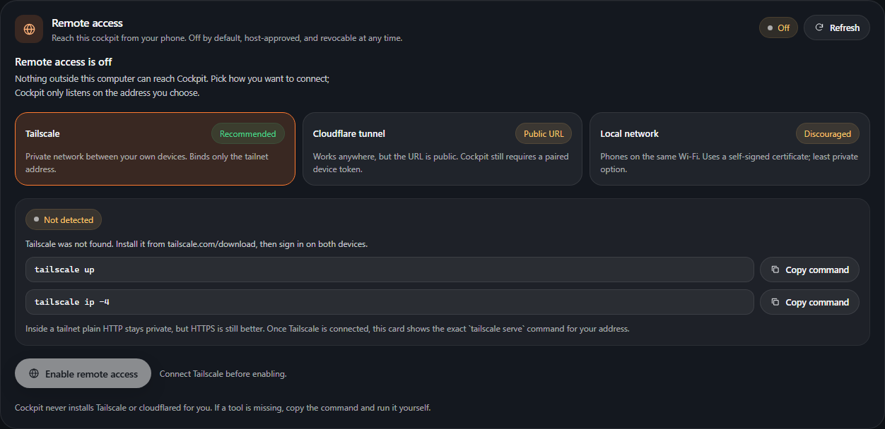
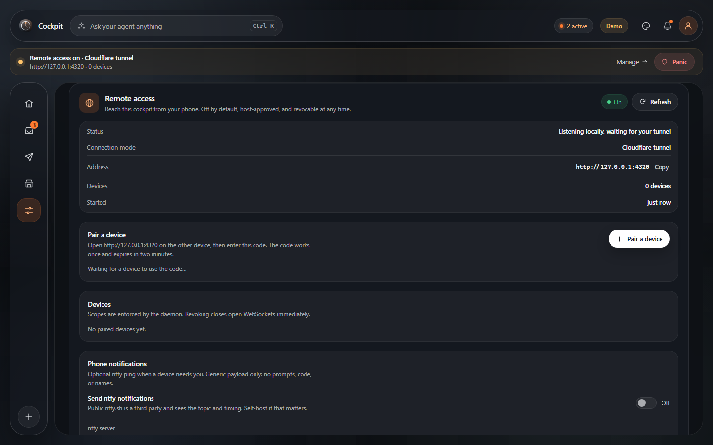
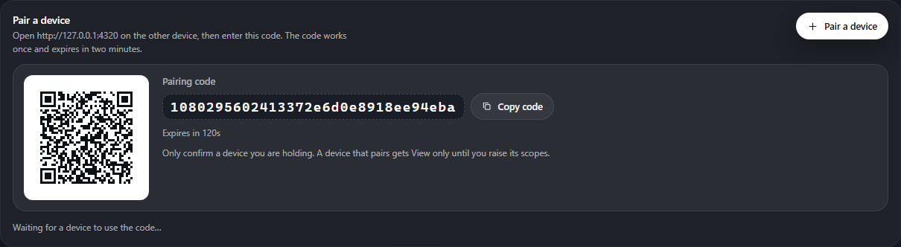
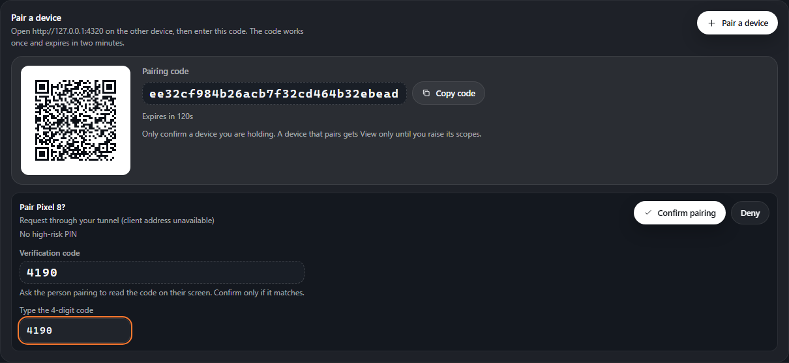
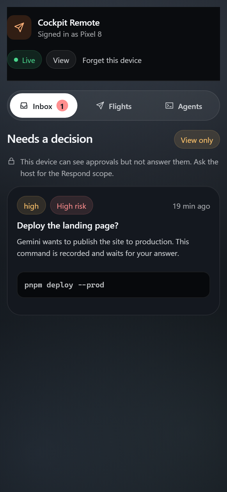
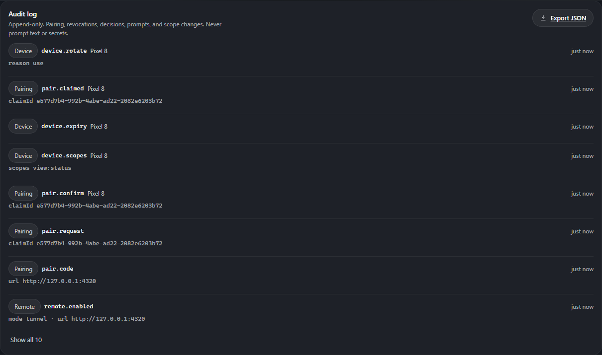
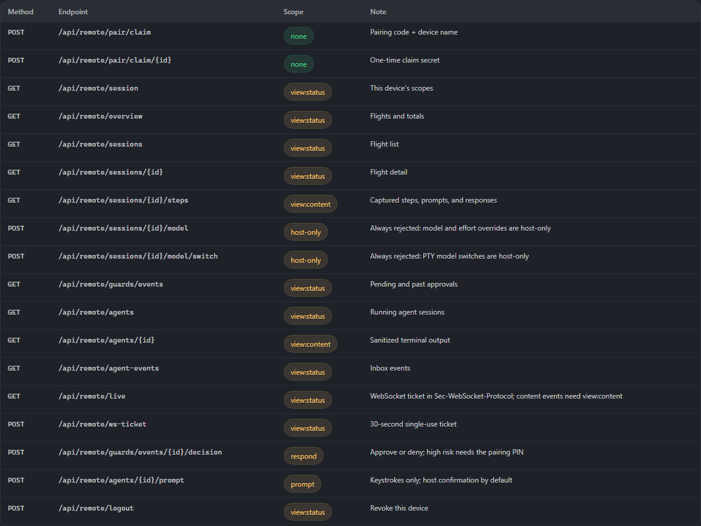

# Remote access

Status: Phase 7. Remote access is optional, **off by default**, and can be
switched off or revoked at any time from the computer running Cockpit.

This guide is written for someone who has never used Tailscale or a Cloudflare
tunnel. Follow one option, then pair your phone. If you only read one section,
read [Safety rules](#safety-rules) and [Pairing a device](#pairing-a-device).



## What remote access is

Remote access lets a phone or another computer open a small, separate Cockpit
dashboard. It is for checking on work while you are away:

- See recent flights, running agents, and terminal output.
- See pending approvals.
- Approve or deny guarded actions (with the Respond scope).
- Send a prompt into an agent session that is already running (with the Prompt
  scope).

It is **not** a remote desktop, a shell, or a way to start new agents. The
computer still owns the agent process, the terminal, and every decision. A
paired device cannot:

- start, stop, or spawn a process;
- change settings, adapters, rules, or budgets;
- pair another device or manage tokens;
- read the audit log (the host can export it);
- reach the model proxy (`/v1`, `/openai`, `/anthropic`, `/s/...`) — those
  paths return 404 on the remote listener;
- complete a sign-in, password, or two-factor prompt. Those always say
  **"Needs you at the computer."**

The remote listener is a second, separate HTTP listener. The normal Cockpit
listener stays on loopback. Turning remote access off removes the second
listener; it does not change how the local app works.

## Safety rules

1. Remote access is off until you turn it on from **Settings → Remote access**
   on the computer. A remote device can never turn it on.
2. New devices start with **Status** only. Content is opt-in and can read code
   and anything your agent printed. You raise scopes per device, one at a time.
3. **Prompt** is the dangerous scope. The host warns you: *"Prompt lets this
   device make your agent run commands."*
4. High-risk approvals require a PIN you set when pairing. If no PIN was set,
   high-risk approvals must happen at the computer.
5. Sign-in and password prompts cannot be answered remotely.
6. The persistent banner at the top of Cockpit shows when remote access is on,
   with a one-click **Panic** button. Panic stops the listener, revokes every
   device, and closes open sockets immediately.
7. Cockpit never installs, starts, or bundles Tailscale or cloudflared. It only
   detects them and shows the command to run yourself.
8. Plain HTTP is used on loopback and, optionally, inside a tailnet. Use
   `tailscale serve` or a Cloudflare tunnel when you want browser HTTPS.

## Before you start

- Cockpit must be running on the computer: `cockpit serve` (or `cockpit demo`
  for demo data).
- Open the local app at <http://127.0.0.1:4319> and go to
  **Settings → Remote access**.
- The remote listener uses port **4320** by default. If that port is busy,
  start the daemon with another port before enabling remote access:

  ```powershell
  $env:COCKPIT_REMOTE_PORT = "4321"
  cockpit serve
  ```

  `COCKPIT_REMOTE_PORT=0` disables the remote listener for that daemon.
- If you build Cockpit from source, build the UI once so the remote listener can
  serve it: `cd ui; pnpm install; pnpm build`. Packaged builds include it.

## Option A — Tailscale (recommended)

Tailscale creates a private network between your own devices. Cockpit binds only
the tailnet address, never `0.0.0.0`, and the traffic is encrypted by
WireGuard. This is the easiest option to use safely.

### A1. Install Tailscale on both devices

1. Create a free account at <https://tailscale.com>.
2. Install Tailscale on the computer that runs Cockpit:
   <https://tailscale.com/download>.
3. Install the Tailscale app on your phone from the App Store or Play Store.
4. Sign in to the **same account** on both devices.

### A2. Connect the computer

Open a terminal on the computer and run:

```powershell
tailscale up
```

Follow the sign-in link if Tailscale asks. Then check the address:

```powershell
tailscale ip -4
```

You should see an address starting with `100.`. That is the tailnet address
Cockpit will bind.

### A3. Enable Cockpit

1. In Cockpit, open **Settings → Remote access**.
2. Choose **Tailscale**.
3. The card should show **Detected** and the `100.x` address. If it says
   **Not detected**, install Tailscale, reopen the terminal, and restart
   Cockpit.
4. Optional but recommended: run the `tailscale serve` command shown in the
   card. It looks like:

   ```powershell
   tailscale serve --bg http://100.x.y.z:4320
   ```

   Tailscale then prints an HTTPS address such as
   `https://your-computer.your-tailnet.ts.net`. Use that address on your phone.
   If you skip this step, use `http://100.x.y.z:4320`; it is still private to
   the tailnet, but the browser will not show a padlock.
5. Click **Enable remote access**. The status changes to **Listening**.



> The pairing QR always contains the direct tailnet URL. If you want HTTPS,
> open the `https://…ts.net` address from `tailscale serve` on the phone and
> enter the same pairing code there. The code is not tied to one URL.

### A4. Pair your phone

See [Pairing a device](#pairing-a-device).

## Option B — Cloudflare tunnel (works anywhere, public URL)

Use this when the phone is not on the same tailnet. The tunnel URL is reachable
from the public internet, so Cockpit authentication is always required. For
regular use, prefer a **named tunnel with Cloudflare Access** instead of a quick
tunnel.

### B1. Install cloudflared

Install `cloudflared` from the Cloudflare documentation:
<https://developers.cloudflare.com/cloudflare-one/connections/connect-networks/downloads/>.

Cockpit does not install it for you. After installing, reopen the terminal so
Cockpit can detect it on `PATH`.

### B2. Start the tunnel

In a terminal on the computer, run the exact command shown in the Cockpit card.
It looks like:

```powershell
cloudflared tunnel --url http://127.0.0.1:4320
```

The tunnel prints a public URL such as
`https://random-words.trycloudflare.com`. Leave this terminal running.

> A quick tunnel is public and temporary. Anyone with the URL can reach the
> Cockpit sign-in page, but they still need a paired device token. A named
> tunnel with Cloudflare Access adds an identity check in front of Cockpit.

### B3. Enable Cockpit

1. In **Settings → Remote access**, choose **Cloudflare tunnel**.
2. Paste the public URL into **Public URL**.
3. Read the warning: *"This URL is reachable from the public internet."*
4. Click **Enable remote access**.
5. Pair your phone using the QR code or the URL and code.

Cockpit binds only `127.0.0.1:4320` in this mode; `cloudflared` makes the
outbound connection. Do not expose the remote port directly on your router.

## Option C — Local network (discouraged)

This mode is for a phone on the same Wi-Fi when Tailscale is not an option. It
is the least private choice.

- Cockpit binds only the detected LAN address (for example
  `192.168.1.20:4320`), never `0.0.0.0`.
- The listener uses a self-signed TLS certificate. Your phone will show a
  certificate warning.
- Anyone on the same Wi-Fi can reach the sign-in page. They still need a paired
  token, but the page is visible.
- The pairing QR includes the certificate fingerprint. Compare the fingerprint
  in the phone's certificate warning with the one shown on the host before you
  continue.

The certificate and key live under `$COCKPIT_HOME/remote-tls/`. Deleting them
makes Cockpit generate a new certificate and fingerprint the next time LAN mode
starts.

If you can use Tailscale, use Tailscale instead.

## Pairing a device

Pairing is always a two-step flow: the device asks, and the host confirms.

1. On the computer, with remote access on, click **Pair a device**.
2. Cockpit shows a **pairing code** and a QR code. The code is 128 bits of
   randomness, works **once**, and expires in **two minutes**.

   

3. On the phone, open the remote URL (scan the QR or type the URL).
4. Enter the pairing code and a device name, for example `Pixel 8`.
5. Set a **high-risk PIN** of 6–12 digits. You will need this PIN to approve or
   deny high-risk actions from this device, and the phone keeps only its slow
   Argon2id hash. Without a PIN, high-risk approvals must happen at the computer.
6. Tap **Send pairing request**. The phone shows a **four-digit verification
   code** and says *"Waiting for the host to confirm…"*. Compare that code with
   the one on the computer.
7. On the computer, Cockpit shows **Pair Pixel 8?** with the same four-digit
   code, the request IP when it can be trusted, and whether a PIN is set. Type
   the code and click **Confirm pairing**. A tunnel request without a validated
   forwarded address says the client address is unavailable rather than showing
   the local tunnel connector.

   

8. The device receives its token exactly once and shows a summary: it starts
   with **Status** only, cannot read content, and explains what the PIN does.
   Open the dashboard from there.

   

If the code expires, create a new one. A code cannot be reused, and a denied
request never receives a token. Only one code is active at a time — creating a
new one replaces the old code. Up to three requests can wait for the host at
once; answer or deny one before another device can join the queue.

### What the device stores

The device keeps its bearer token in the browser's local storage for that
origin. The host stores only a SHA-256 hash of the token. The token is sent in
the `Authorization: Bearer …` header, never in a URL or query string. The live
WebSocket uses a 30-second, single-use ticket in the
`Sec-WebSocket-Protocol: cockpit.<ticket>` header, never in the URL.

Tokens expire after 30 days without use. You can rotate or revoke a token at
any time from the host.

## Scopes

Scopes are enforced by the daemon, not by hiding buttons in the UI.

| Scope | What it allows | Notes |
| --- | --- | --- |
| **Status** (`view:status`) | See flights, sessions, agents, costs, counts, pending approvals, and inbox events. | Every device starts here. |
| **Content** (`view:content`) | Read terminal output, steps, diffs, prompts, and responses. | Opt-in. The host warns: *"Content can read code and anything your agent printed."* |
| **Respond** | Approve or deny guarded actions. | High-risk actions also need the pairing PIN. |
| **Prompt** | Type into an agent session that is already running. | The host warns: *"Prompt lets this device make your agent run commands."* |

Raise scopes per device in **Settings → Remote access → Devices**. Lowering a
scope takes effect on the next request and on the next live message. No scope
grants host management, settings, pairing, token rotation, audit access, or
model-proxy access.

### High-risk approvals

An approval is high risk when its severity is High or Critical, or when it is a
dangerous command. From a remote device:

- If the device has a PIN, the phone asks for it before approve or deny.
- If the device has no PIN, the action must be completed at the computer.
- A wrong PIN is rate-limited and audited. Five wrong PINs lock Respond for
  that device with **423 respond_locked**; the host must click **Reset Respond**
  in the device list to clear the lock.
- Replayed or expired approvals are refused.

Sign-in, password, API-key, and two-factor prompts are never sent to a remote
device as something it can answer. The phone shows **"Needs you at the
computer"** and the host does the sign-in in the agent's terminal.

## Remote prompts

A prompt from a phone is only keystrokes into a session that the Cockpit CLI is
already running. It cannot start a new process or choose a working directory.

- Maximum 2,000 characters; NUL is rejected.
- Limited to 6 prompts per minute per device.
- **Require host confirmation for remote prompts** is **on by default**. The
  prompt waits in **Pending remote prompts** on the host until you approve it.
- If you turn confirmation off for a device, the prompt is queued as keystrokes
  plus Enter immediately.
- The host sees **"Remote prompt sent from Pixel 8"**, the byte size, and a
  SHA-256 prefix. The prompt text is held in memory only until you decide, and
  it is never written to the audit log.
- A remote prompt cannot answer a sign-in or password prompt.

## Managing devices

The **Devices** section lists each device by name, its scopes, when it was last
seen, and whether it is active or revoked.

- **Raise/lower scopes** — changes are saved per device. Granting Prompt shows
  the plain-language warning.
- **Rotate token** — creates a new token and stops the old one immediately. The
  new token is shown once; copy it to the device.
- **Revoke** — the device's open tabs and WebSockets stop working immediately.
  Pair again to restore access.
- **Panic** — stops the remote listener, revokes every device, and clears
  pending prompts. Use this if a phone is lost or you are unsure.

Remote access does **not** start automatically when the daemon restarts. Paired
devices stay in the database, but you must turn remote access on again from the
host. This is intentional.

## Audit log

Every sensitive transition is appended to a local audit log:

- pairing code created, requested, confirmed, denied, or failed;
- device revoked, rotated, or scope changed;
- login failures and expired tokens;
- every approve and deny;
- every remote prompt (size and hash only, never text);
- remote access enabled/disabled and panic;
- notification settings changed.

The log is viewable and exportable as JSON from **Settings → Remote access**.
It is host-only; a paired device cannot read it. It never contains tokens,
passwords, prompt text, or terminal output.



## Phone notifications (ntfy)

Cockpit can send an optional ntfy ping when a device is waiting for pairing,
sends a prompt for confirmation, or needs a decision. This is **off by
default**.

- The payload is generic: *"A device is waiting for pairing confirmation."*,
  *"A paired device sent a prompt that needs host confirmation."*, or
  *"A paired device needs a decision."* It contains no prompt text, device name,
  project name, or path.
- The topic is 256 bits of random data, not a guessable word.
- **Public ntfy.sh is a third party.** It sees the topic and timing. If that
  matters, self-host ntfy and set the server URL to your own HTTPS server (or
  `http://127.0.0.1` for a local test).
- Configure it under **Settings → Remote access → Phone notifications**. Use
  **Send test** to verify.

## Turning remote access off

- **Turn off remote access** in Settings stops the listener. Paired devices
  remain in the database for next time.
- **Panic** stops the listener *and* revokes every device. Use Panic when a
  device is lost or you suspect a token leaked.
- Quitting the daemon also stops the remote listener. The next daemon start
  begins with remote access off.
- If you suspect the host itself is compromised, stop Cockpit, remove the
  `remote_devices` rows only if you know what you are doing, and review the
  audit export. The supported path is Panic, then pair again.

## Troubleshooting

### The phone cannot reach the URL

- Is the daemon running? Open <http://127.0.0.1:4319> on the computer.
- Is remote access **Listening** in Settings? It does not auto-start after a
  daemon restart.
- Tailscale: are both devices signed in to the same tailnet? Run
  `tailscale status` on the computer and check that the phone is listed.
- Cloudflare: is the `cloudflared` terminal still running? Quick tunnel URLs
  change when it restarts; paste the new URL and enable again.
- LAN: is the phone on the same Wi-Fi? Some guest networks block device-to-
  device traffic.
- Check the firewall. Cockpit binds only the chosen address, but the OS may
  still need to allow the port on a private network.

### Tailscale is not detected

- Install it from <https://tailscale.com/download> and reopen the terminal.
- Run `tailscale up` and complete the sign-in.
- Restart Cockpit so it re-detects the tool and address.
- If Tailscale is installed but not connected, Cockpit refuses to enable
  Tailscale mode; that is deliberate.

### cloudflared is not detected

- Install it and reopen the terminal (or restart Cockpit).
- Run the exact command shown in the card. The port must match
  `COCKPIT_REMOTE_PORT` (default 4320).
- A quick tunnel URL is public. Do not paste it into a chat or screenshot
  without thinking about who can see it.

### The phone shows a certificate warning (LAN mode)

That is expected: LAN mode uses a self-signed certificate. Compare the
fingerprint in the warning with the one shown in Cockpit. If they match, you can
continue. If you do not want to see this warning, use Tailscale with
`tailscale serve` or a Cloudflare tunnel.

### The pairing code expired

Codes last two minutes and work once. Click **Pair a device** again and use the
new code. A denied request cannot be retried with the same code.

### The host never shows "Pair <name>?"

- Keep **Settings → Remote access** open on the host.
- Check **Pending pairing requests**; refresh the card.
- The device may have used an expired code, or the request may have been
  rate-limited after too many wrong codes. Create a fresh code.

### The remote page shows a placeholder instead of Cockpit

The remote listener serves the built UI from `ui/dist`. Build it with
`pnpm build` in `ui/`, or point `COCKPIT_UI_DIR` at a built UI directory, then
restart the daemon.

### A remote page returns 404

Only the remote dashboard and `/api/remote/*` exist on the remote listener.
Model proxy paths (`/v1`, `/openai`, `/anthropic`, `/s/...`) and host management
routes are intentionally absent. Use the local Cockpit URL for those.

### "Needs you at the computer"

Sign-in, password, API-key, and two-factor prompts cannot be completed from a
remote device. Go to the computer and use the agent's own terminal.

### The device was revoked

Revocation is immediate and closes open sockets. Pair the device again with a
new code. If you did not revoke it, use Panic and review the audit log.

### The remote port is busy

Change `COCKPIT_REMOTE_PORT` before starting the daemon, then re-enable remote
access. The suggested `tailscale serve` and `cloudflared` commands use the
configured port.

## Command-line pairing (optional)

The Settings screen is the normal path, but `cockpit pair` exists for terminals
and scripts.

Host side — issue a code through the local daemon:

```powershell
cockpit pair
```

Device side — claim the code from another machine or terminal:

```powershell
cockpit pair --claim ABCD-EFGH --url https://your-remote-url --device-name "Phone" --pin 123456
```

The device prints a four-digit verification code; compare it with the host
before confirming. The host still has to confirm the device in **Settings →
Remote access**. The device prints its token once. `--pin` is optional but must
be 6–12 digits; without it, high-risk approvals must happen at the computer.

## Endpoints and scopes

The remote listener exposes only the routes below. The same matrix is shown in
**Settings → Remote access → Endpoints and scopes**.

| Method | Endpoint | Scope | Note |
| --- | --- | --- | --- |
| GET | `/api/remote/health` | view:status | 404 unless loopback or a valid device token; version only when authenticated |
| POST | `/api/remote/pair/claim` | none | Pairing code + device name |
| POST | `/api/remote/pair/claim/{id}` | none | One-time claim secret |
| GET | `/api/remote/session` | view:status | This device's scopes |
| GET | `/api/remote/overview` | view:status | Flights and totals |
| GET | `/api/remote/sessions` | view:status | Flight list |
| GET | `/api/remote/sessions/{id}` | view:status | Flight detail |
| GET | `/api/remote/sessions/{id}/steps` | view:content | Captured steps, prompts, and responses |
| GET | `/api/remote/guards/events` | view:status | Pending and past approvals |
| GET | `/api/remote/agents` | view:status | Running agent sessions |
| GET | `/api/remote/agents/{id}` | view:content | Sanitized terminal output |
| GET | `/api/remote/agent-events` | view:status | Inbox events |
| GET | `/api/remote/live` | view:status | WebSocket ticket in `Sec-WebSocket-Protocol`; content events need `view:content` |
| POST | `/api/remote/ws-ticket` | view:status | 30-second single-use ticket |
| POST | `/api/remote/guards/events/{id}/decision` | respond | Approve or deny; high risk needs the pairing PIN |
| POST | `/api/remote/agents/{id}/prompt` | prompt | Keystrokes only; host confirmation by default |
| POST | `/api/remote/logout` | view:status | Revoke this device |

Everything else, including `/v1`, `/openai`, `/anthropic`, `/s/...`, and the
host management routes, returns 404 on the remote listener.



## Security details

The full threat model, per-scope stolen-token impact, revocation steps, and the
endpoints × scopes table live in [`security.md`](security.md). The short
version:

- Remote access is a separate listener and a separate router.
- Host controls stay on the computer and reject cross-site requests: every
  state-changing host call needs the loopback `Origin`, `Content-Type:
  application/json`, and a per-process CSRF token from `GET /api/csrf`. A
  cross-origin form or `no-cors` request cannot enable remote access, create a
  code, confirm a pairing, change scopes, decide an approval, revoke, or panic.
- Pairing is host-confirmed; the host must echo the device's four-digit
  verification code, and codes are single-use and short-lived.
- High-risk PINs are set on the device, must be 6–12 digits, and are stored as
  Argon2id hashes. Five wrong PINs lock Respond until the host resets it.
- Tokens are 256-bit, stored hashed, sent in a header, compared in constant
  time, and revoked immediately.
- Scopes are enforced server-side on every request and every live message.
- WebSocket upgrades check `Origin`, use a one-time ticket, and re-check scope
  and revocation.
- Security headers are set on every remote response; no CORS headers are
  emitted, and cookies are not used.
- `/api/remote/health` is not an unauthenticated fingerprint: it returns 404
  unless called from loopback or with a valid device token.
- Rate limits, exponential lockout, a connection cap, and a body-size limit
  apply to the remote listener.
- The audit log records sensitive transitions without secrets or prompt text.
